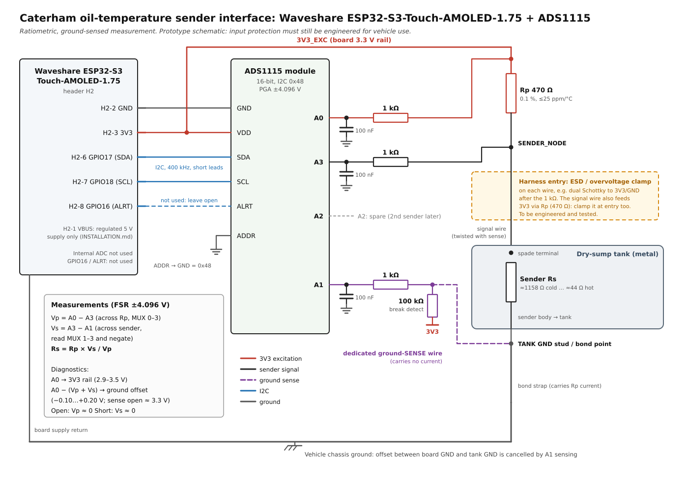

# Wiring (Waveshare ESP32-S3-Touch-AMOLED-1.75 standard / -B + ADS122C04)

The sender is measured by an **Adafruit ADS122C04 24-bit I²C ADC module** (product 6432), not by the ESP32-S3's internal ADC. The ADC's own **current source** drives 250 µA through a **reference resistor (Rref)** and then the sender. The firmware reads the voltage across each and computes

`Rs = Rref × Vs / Vref`

The same current flows through both resistors, so the current's own accuracy (±6 %), the ADC's reference and the 3.3 V rail all cancel. A dedicated **ground-sense wire** to the tank removes any ground offset between the gauge and the tank.

The whole front end is **three resistors** soldered to the module's pins, plus a terminal strip for the harness. There's no interface PCB or stripboard. The display runs from **USB-C**, and the module runs from the display's 3.3 V.

## Display socket (header H2)

The display case has an 8-way socket. Read from the back, its label reads `18 17 16 RX TX 3.3V G 5V`. Waveshare's schematic calls it `H2`; consult the revision-specific schematic before attaching anything.

| Case label | H2 pin | Signal | Use |
|---|---:|---|---|
| 18 | 7 | GPIO18 | **I²C SCL** to the module's SCL (on the `-G` model this pin may be used by GNSS; that model is not supported) |
| 17 | 6 | GPIO17 | **I²C SDA** to the module's SDA |
| 16 | 8 | GPIO16 | Not used |
| RX / TX | 4 / 5 | GPIO44 / GPIO43 | Not used |
| 3.3V | 3 | 3V3 | The module's VIN (its AVDD and DVDD). Never connect vehicle 12 V |
| G | 2 | GND | The module's GND, and through it the harness's return wire |
| 5V | 1 | VBUS | Not used: the display is powered from its USB-C socket |

The firmware uses I²C port 0. The Waveshare BSP already uses port 1 (GPIO14/15) for the touch panel and on-board peripherals. The module has 10 kΩ pull-ups on SDA and SCL to its VIN, so no extra pull-ups are needed. Keep the display lead short (20 cm or less) and **never run the I²C bus to the tank**: only the analogue harness goes there.

## Module connections

The module has two rows of six holes ([Adafruit's guide](https://learn.adafruit.com/adafruit-ads122c04-24-bit-adc/pinouts)):
- **Top row:** `Ref+ A0 A1 A2 A3 Ref-`.
- **Bottom row:** `VIN GND SCL SDA DRDY !RST`.

It has no regulator. Its analogue pins go straight to the chip, with no filter parts, and the chip's AVDD comes from VIN through a ferrite.

| Module pin | Connects to | Purpose |
|---|---|---|
| VIN | display `3.3V` | Supply |
| GND | display `G`, and the terminal strip's `RETURN` | Ground |
| SDA / SCL | display `17` / `18` | I²C, address **0x40** (address jumpers open) |
| **A0** | **Rref** to `SENDER` | The current source's output, and the top of Rref |
| **A1** | **2.2 kΩ** to `SENDER` | Sender high side |
| **A2** | **2.2 kΩ** to `SENSE` | Sender low side, via the ground-sense wire |
| A3, Ref+, Ref−, DRDY, !RST | Nothing | The datasheet allows unused analogue inputs to float. The firmware polls for results, so DRDY is unused; !RST has a pull-up on the module |

## Parts

| Ref | Part | Where |
|---|---|---|
| Rref | **2.00 kΩ, 0.1 %, ≤ 25 ppm/°C** metal film, 0.25 W | A0 to `SENDER`. It's the measurement reference: measure it and put the value in `kReferenceOhms` (`main/Config.h`) |
| R1 | 2.2 kΩ, 1 %, 0.25 W | A1 to `SENDER` |
| R2 | 2.2 kΩ, 1 %, 0.25 W | A2 to `SENSE` |

R1 and R2 limit the current into the ADC if a harness wire shorts to the battery, and they let the firmware check both taps (below). The ADC draws only nanoamps, so they add no measurable error. Use 2.2 kΩ for both: the firmware's ground-offset reading assumes it (`kGroundSenseBiasV`).

## Building it without a board

1. **Bottom row:** snap a 6-pin piece off the header strip that comes with the module. Solder it into the bottom row (VIN … !RST), long pins up, so the wires solder onto pins rather than into holes.
2. **Display lead:** use a 5-core lead of 20 cm or less, with an 8-pin piece of 2.54 mm header as the plug for the display socket.
   - At the plug, solder the lead to the pins under `18`, `17`, `3.3V` and `G` (two wires on `G`). The pins under `16`, `RX`, `TX` and `5V` carry nothing.
   - At the module, solder SCL, SDA, VIN and GND to their pins.
   - The fifth wire, from the plug's `G`, goes to the terminal strip's `RETURN`.
   - Offer the plug up to the case and check that its `18` pin meets the socket labelled 18 before soldering.
3. **Resistors:**
   - Fit Rref into A0, R1 into A1 and R2 into A2 from the chip side, and solder them underneath.
   - Lay the bodies flat, pointing away from the module, and sleeve the long leads.
   - Leave A3, Ref+ and Ref− empty.
4. **Terminal strip:** a 3-way screw terminal strip (a "chocolate block" cut to three ways) is the harness connector.
   - `SENDER` takes the far leads of Rref and R1, twisted and soldered together, plus the harness signal wire.
   - `SENSE` takes R2's far lead and the harness ground-sense wire.
   - `RETURN` takes the lead's fifth wire and the harness return wire.
   - Crimp ferrules on the harness wires.
5. **Box:**
   - Screw the module to the floor of a small insulated box by its four mounting holes, and fix the terminal strip beside it.
   - Hold the resistor bodies down with hot-melt glue or silicone so they can't flex their leads.
   - Bring both cables in through strain reliefs.

Every joint is soldered except the terminal strip, which you can open to disconnect the harness.

## Wires to the tank

Run three conductors from the terminal strip to the tank, twisted together (or in a screened cable, with the screen grounded at the gauge end only). Route them away from ignition leads, the alternator and the exhaust.

1. **Signal** (`SENDER`): to the sender spade.
2. **Ground sense** (`SENSE`): to the tank bond stud. It carries only the 10 µA wiring-check current, so it reads the true tank potential.
3. **Return** (`RETURN`): from the gauge's ground to the tank bond stud. It carries the 250 µA excitation current back.

**Why the return wire is needed:** with the display on USB-C, nothing guarantees the gauge's ground reaches the chassis. A power bank floats, and a USB charger's ground arrives through its own 12 V socket. Without the return wire on a floating supply, no current flows and the gauge shows `SENSOR OPEN` or `GROUND FAULT`, never a reading. The ground-sense wire still measures the tank, so the return wire's resistance doesn't matter.

## Engineering calculations

The current source pushes `I` (250 µA nominal) out of A0, through Rref and the sender, to the tank:

* `Vref = V(A0) − V(A1) = I × Rref` (multiplexer setting AIN0–AIN1)
* `Vs = V(A1) − V(A2) = I × Rs`, where A2 reads the tank through the ground-sense wire (AIN1–AIN2)

Therefore `Rs = Rref × Vs / Vref`.
- **What cancels:** the current's value, the ADC's reference and the rail. All six readings use the same gain (1, PGA bypassed) and the internal 2.048 V reference, so the ADC gain error cancels as well.
- **What remains:** mainly Rref's tolerance and drift. Use a 0.1 % / ≤ 25 ppm/°C part and put its **measured** value in `kReferenceOhms`.
- **Signal wire:** its resistance from `SENDER` to the spade is included in `Rs` (typically under 0.1 Ω, which calibration in place absorbs).

**Each 250 ms cycle** the ADC makes six single-shot conversions at 45 samples/s (about 150 ms in all):

1. **Offset:** the inputs shorted internally. This is the ADC's own offset (a few µV), subtracted from Vref and Vs. If it's beyond 0.25 mV, the gauge shows `ADC UNAVAILABLE`.
2. **Vref:** A0 − A1.
3. **Vs:** A1 − A2.
4. **Ground:** A2 to ground, with the ADC's 10 µA burn-out source on. The tank's offset from the gauge GND is this reading minus the source's 22 mV drop across R2.
5. **Sender tap:** A1 to ground, with the burn-out source on.
6. **Supply:** AVDD, through the ADC's own monitor.

**Data integrity:**
- Before every conversion, the driver writes all four configuration registers and reads each back with a CRC.
- Every result carries a CRC16 and a conversion counter.
- Any I²C error, CRC failure, register mismatch, timeout or out-of-sequence counter makes that cycle `ADC UNAVAILABLE`, never a stale value.

**Compliance:** the current source holds its current only while A0 stays at least 0.9 V below AVDD. A0 sits at `I × (Rref + Rs)` plus the tank offset. At the open-circuit threshold (5 kΩ), a +0.2 V offset and AVDD at its 2.9 V limit, that's 1.95 V, under the 2.0 V limit. So everything the gauge reads as a resistance is measured with a steady current.

**Diagnostics:**

* **Supply** outside 2.9–3.5 V: `SUPPLY FAULT`.
* **Excitation current** `Vref / kReferenceOhms` outside 210–290 µA: `SUPPLY FAULT`. The source is 250 µA ± 6 %, so this catches a missing or wrong Rref (for example 2.4 kΩ fitted where 2.0 kΩ is configured). A wrong Rref would otherwise give a plausible but wrong resistance.
* **Tank ground offset** outside −0.10…+0.20 V: `GROUND FAULT`. The ADC is specified for inputs from 0.1 V below its GND, so keep the offset near 0 V.
* **Sender open:** no current flows, so `Vref ≈ 0`: `SENSOR OPEN`. The same applies to a sender resistance over 5 kΩ.
* **Sender shorted to ground:** `Vs ≈ 0`, or under 20 Ω: `SENSOR SHORT`.
* **Ground-sense wire broken, or R2's joint open:** the burn-out source pulls A2 up towards AVDD, so `GROUND FAULT`.
* **R1's joint open** (A1 tap): the burn-out source pulls A1 up, and the tap check gives `SENSOR OPEN`. An intact tap reads the sender node plus 10 µA × Rs.
* **Rref or A0's joint open:** no current reaches the sender, so `Vs ≈ 0`: `SENSOR SHORT`. Either way it's a fault, never a reading.

**Expect the offset to be slightly negative in the car.** The display's supply current returns through its own ground, so the gauge GND can sit slightly above the tank. A2 then sits slightly below GND. The ADC is specified down to 0.1 V below its GND with the PGA bypassed, which is why the firmware accepts offsets down to −0.10 V (`kGroundOffsetMinV`). Bench step 8 checks that readings stay accurate there.

### Resolution

- **Step size:** one ADC step is 0.24 µV, and the noise at 45 samples/s is about 6.6 µV rms.
- **Near 130 °C:** the TT6811-03 curve changes by about 1.7 Ω per °C, which is 0.43 mV per °C at 250 µA. That gives about 0.02 °C of noise before the gauge's filter.
- **What sets accuracy:** Rref, the calibration and the thermal coupling, not the converter.

## Expected indicative voltages

These **voltages are theoretical electrical examples**, not a calibrated oil-temperature table. They assume 250 µA, Rref = 2.00 kΩ and zero ground offset.

| Sender resistance | Vs = A1 − A2 | Vref = A0 − A1 | A0 |
|---:|---:|---:|---:|
| 44 Ω | 11.0 mV | 0.500 V | 0.511 V |
| 120 Ω | 30.0 mV | 0.500 V | 0.530 V |
| 470 Ω | 117.5 mV | 0.500 V | 0.618 V |
| 1,158 Ω | 289.5 mV | 0.500 V | 0.790 V |
| 5,000 Ω (open threshold) | 1.250 V | 0.500 V | 1.750 V |
| Disconnected (open) | — | ≈ 0 V | near 3.3 V |
| Signal shorted to ground | ≈ 0 V | 0.500 V | 0.500 V |

**Self-heating is negligible.** The sender dissipates at most 72 µW at 1,158 Ω, and Rref 125 µW.

## Input protection

There are **no clamp diodes or TVS**. Instead, every harness wire reaches the ADC only through at least 2 kΩ: Rref and R1 on the signal wire, R2 on the sense wire. The chip's own input clamps are rated for 10 mA continuous.

- **Wire shorted to 14.4 V:** the signal wire pushes about 5.5 mA into A0 and 5 mA into A1, and the sense wire 5 mA into A2.
- **24 V jump start:** about 10 mA per pin, at the rating.
- **Where it goes:** that current flows into the display's 3.3 V rail through the chip. The display draws far more than that, so the rail shouldn't rise, but nothing guarantees it.
- **Compared with the old pull-up circuit:** the harness no longer reaches the 3.3 V rail through a low resistance.

This is **not** load-dump, surge or ESD qualification. Bench test the short to battery (step 12) before fitting, and check the installed system in the car; see [SAFETY.md](../docs/SAFETY.md).

## Bench steps

The module, the three resistors and a test resistor fit on a breadboard for these steps. Wire them as in the schematic: the test resistor goes from `SENDER` to a bench "tank" point, and the sense and return wires go to that same point.

1. Before connecting the display, check the wiring for unintended shorts. In particular, `SENDER` and `SENSE` must not touch 3.3 V or GND.
2. Power the display from USB on the bench. Check the 3.3 V pin is stable.
3. Confirm the firmware (or an I²C scan) finds the module at **0x40**.
4. Fit a **known** 120 Ω resistor as the sender, and the measured Rref value in `kReferenceOhms`. With a DMM, Vs should be about 30 mV and Vref about 0.50 V.
5. Check the firmware's resistance reads close to 120 Ω. This agreement is not a temperature calibration.
6. Remove the resistor: expect `SENSOR OPEN`. Short `SENDER` to the tank point through safe test leads: expect `SENSOR SHORT`.
7. Add 10 Ω in the return wire only, between the tank point and the gauge GND. The resistance reading shouldn't change. The CSV's `ground_offset_v` rises by only about 2.5 mV, because the return wire carries just 250 µA. To test the offset window itself, use step 8.
8. **Tank point below and above GND.** Replace the return wire with 1 Ω between the tank point and the gauge GND. Connect a 1.5 V AA cell in series with 27 Ω across that 1 Ω: cell + → 27 Ω → gauge GND, cell − → tank point. That holds the tank point about 50 mV below GND.
   - Expect no fault, `ground_offset_v` about −0.05 V in the CSV log, and the resistance within about 0.2 % of the step 5 reading.
   - With 12 Ω instead of 27 Ω (about −0.11 V), expect `GROUND FAULT`.
   - Reverse the cell for about +0.05 V: no fault, and the same resistance.
   - Afterwards, disconnect the cell and restore the return wire.
9. Vary known resistors across the expected range (44 Ω to 5 kΩ). Record the readings and errors.
10. Disconnect the ground-sense wire at the terminal strip: expect `GROUND FAULT`. Reconnect it.
11. **Tap checks:** unsolder R1's far lead from `SENDER`: expect `SENSOR OPEN`. Then unsolder R2's: expect `GROUND FAULT`. Resolder both. Neither may ever give a reading.
12. **Short to battery:** with a bench supply at 14.4 V, current-limited to 50 mA, touch the signal wire for a few seconds, then the sense wire. Expect a fault while it's applied, no damage, and correct readings afterwards. Re-measure Rref.
13. With the ignition OFF, connect the real sender, ground-sense and return wires. Before turning on gauge power, confirm that no voltage outside 0–3.3 V reaches `SENDER` or `SENSE`.

**Never** probe or splice a powered automobile circuit assuming it is grounded at the same potential as a USB-connected development laptop. Keep the car and laptop disconnected from each other while validating grounds.
