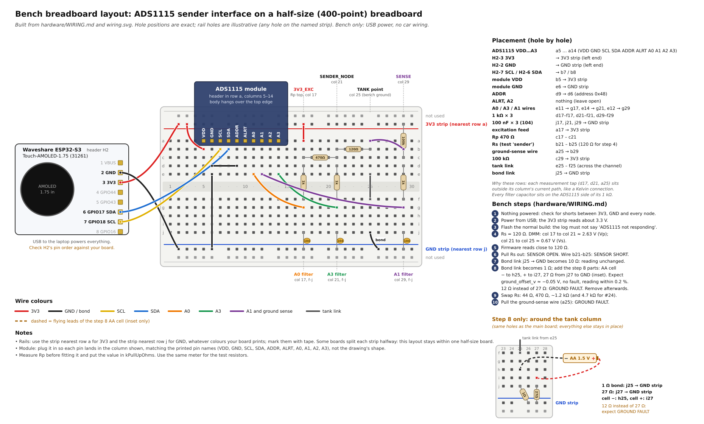
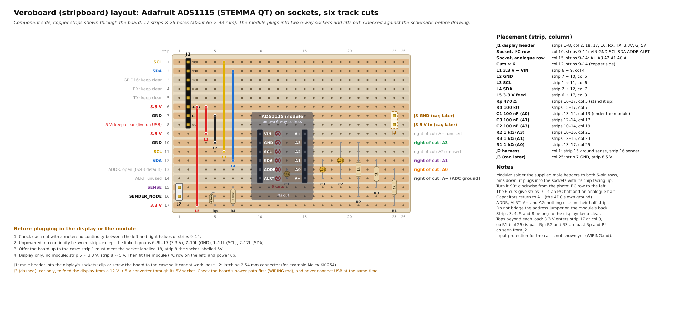
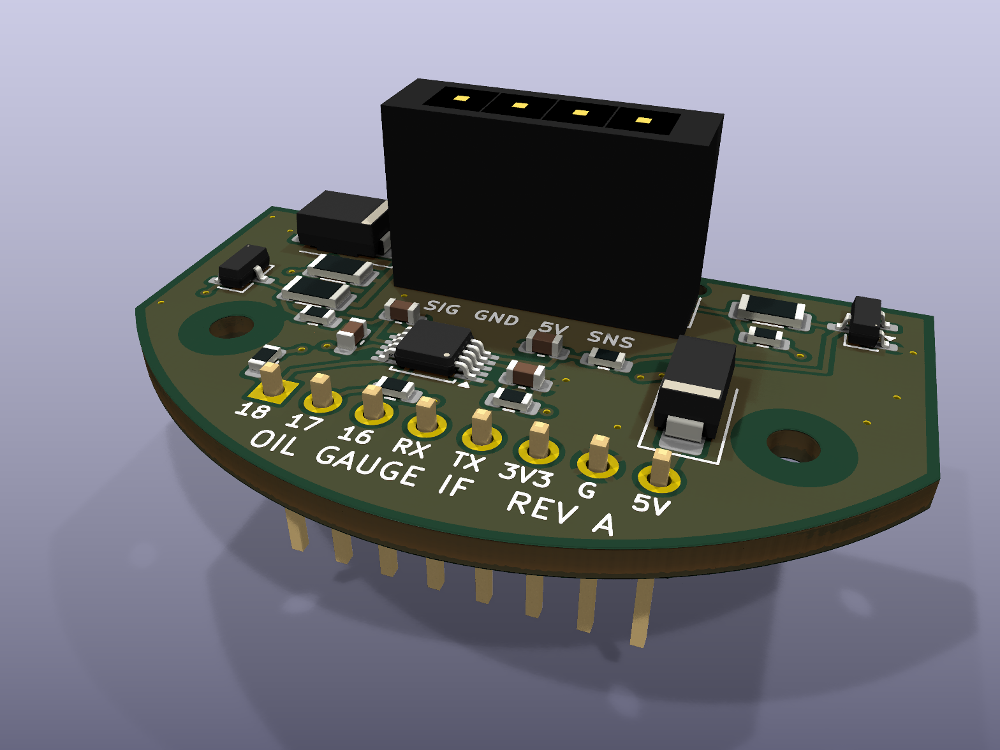
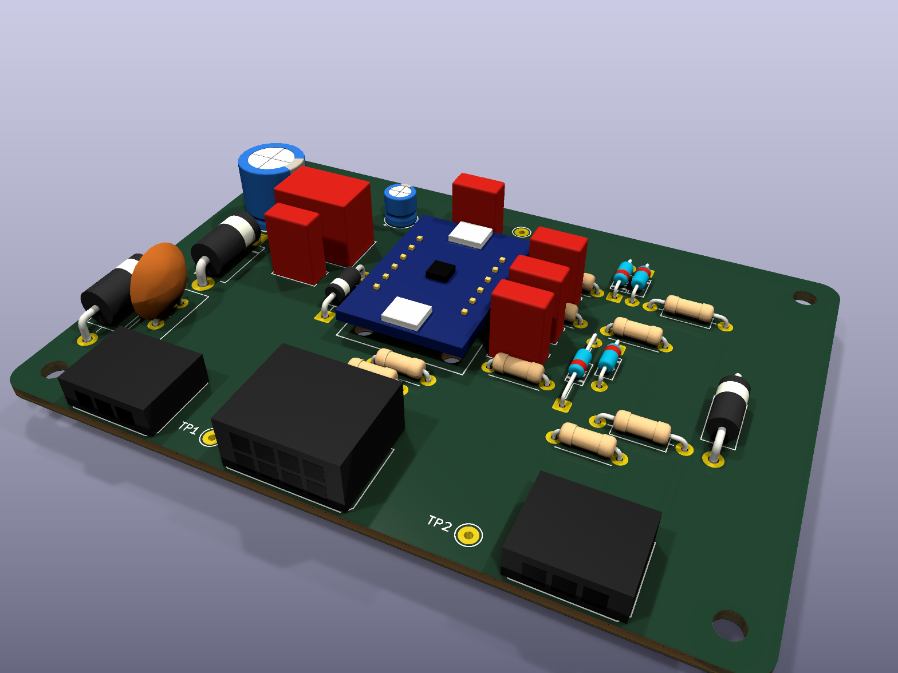

# Wiring (Waveshare ESP32-S3-Touch-AMOLED-1.75 standard / -B + ADS1115)

The sender is measured by an external **ADS1115 16-bit I²C ADC**, not by the ESP32-S3's internal ADC. The ADS1115 measures the voltage across the pull-up and the voltage across the sender, both as **differential** readings, so the result does not depend on the 3.3 V rail or on any ground offset between the electronics and the tank.

## Waveshare header H2

**All pin numbers are for Waveshare's connector `H2`**. Consult the revision-specific schematic and identify pin 1 orientation on the PCB before attaching anything.

| H2 pin | Signal | Use |
|---:|---|---|
| 1 | VBUS | Optional regulated **5 V** board power, only after reviewing the board power-path schematic; otherwise use a properly engineered USB 5 V input. Never 12 V. |
| 2 | GND | ADS1115 GND and all filter-capacitor grounds |
| 3 | 3V3 | ADS1115 VDD **and** the top of the 470 Ω pull-up (excitation). Do not connect to vehicle 12 V |
| 4 | GPIO44 / UART RX | Not used |
| 5 | GPIO43 / UART TX | Not used |
| 6 | GPIO17 | **I²C SDA** to ADS1115 SDA |
| 7 | GPIO18 | **I²C SCL** to ADS1115 SCL (on the `-G` model this pin may be used by GNSS; that model is not supported) |
| 8 | GPIO16 | Not used. The firmware polls the ADS1115 for each result and turns its ALERT/RDY output off, so leave this pin and the module's ALRT unconnected. |

The firmware uses I²C port 0; the Waveshare BSP already uses port 1 (GPIO14/15) for the touch panel and on-board peripherals. The recommended Adafruit ADS1115 module already has 10 kΩ pull-ups on SDA/SCL to its VDD, so no extra pull-ups are needed at 3.3 V. Keep the I²C leads short (ideally < 20 cm) and mount the ADS1115 next to the Waveshare board; **run the analogue sender wires to the tank, never the I²C bus**.

## ADS1115 connections

| ADS1115 pin | Connects to | Purpose |
|---|---|---|
| VDD | H2-3 3V3 | Same rail as the pull-up excitation |
| GND | H2-2 GND | |
| SDA / SCL | H2-6 / H2-7 | I²C, 100–400 kHz |
| ADDR | GND | I²C address **0x48** (check whether your module ties it already) |
| ALRT | Leave unconnected | Not used: the firmware polls for results and turns ALERT/RDY off |
| **A0** | 1 kΩ → top of Rp (`3V3_EXC`), Kelvin tap at the resistor lead | Pull-up high side |
| **A3** | 1 kΩ → `SENDER_NODE` (bottom of Rp, signal wire to sender spade) | Sender high side |
| **A1** | 1 kΩ → **dedicated ground-sense wire** to the tank bond stud, with a **100 kΩ bias resistor** from 3V3 to the sense wire at the gauge-end connector | Sender low side; the bias makes a broken wire read 3.3 V |
| A2 | Spare | e.g. a second sender later |

The 100 kΩ bias goes on the **wire side** of A1's 1 kΩ resistor. When the wire is connected, its 33 µA flows only through the sense wire (a fraction of an ohm), so it adds no measurable error. If the wire breaks, it pulls A1 to 3.3 V and the firmware reports `GROUND FAULT`. Without it, the 100 nF capacitor would hold a broken sense wire near 0 V and the gauge would silently fall back to a ground-referenced measurement.

Each analogue input has a **1 kΩ series resistor** and a **100 nF** (C0G or X7R) capacitor to GND at the ADS1115 pin. Use 1 kΩ, not 10 kΩ: the ADS1115's input impedance is only a few MΩ, and a large series resistance adds gain error.

### Wires to the tank

Run three conductors from the gauge to the tank:

1. **Signal wire**: `SENDER_NODE` to the sender spade terminal.
2. **Ground-sense wire**: ADS1115 A1 (via 1 kΩ) to the tank bond stud. It carries essentially no current, so it reads the true tank potential.
3. **Bond strap / supply ground**: tank to chassis, and the gauge supply ground to chassis. This carries the excitation current (up to about 7 mA) plus whatever else flows in the chassis.

Twist the signal and ground-sense wires together (or use a 2-core screened cable, screen grounded at the gauge end only) and route them away from ignition leads, the alternator and the exhaust.

## Engineering calculations

With pull-up `Rp` (470 Ω) and resistive sender `Rs`, the same current `I` flows through both:

* `Vp = V(A0) − V(A3) = I × Rp` (multiplexer setting AIN0–AIN3)
* `Vs = V(A3) − V(A1) = I × Rs` (read as AIN1–AIN3 and negate; the ADS1115 multiplexer has no AIN3–AIN1 setting)

Therefore

`Rs = Rp × Vs / Vp`

The rail voltage, the ADS1115's reference error and the ground offset between the board and the tank all cancel. Use the **same programmable gain (±4.096 V)** for both readings so the ADC gain error cancels as well. The remaining errors are mainly the tolerance and temperature drift of `Rp`, so use a 0.1 % / ≤25 ppm/°C part and put its **measured** value in `main/Config.h`. The signal-wire resistance from `SENDER_NODE` to the spade is included in `Rs` (typically < 0.1 Ω, which calibration in place absorbs).

Diagnostics:

* `V(A0)` vs GND (single-ended): the 3.3 V excitation rail (`SUPPLY FAULT` if outside 2.9–3.5 V).
* Tank ground offset = `V(A0) − (Vp + Vs)`, which equals `V(A1)` relative to the gauge GND (`GROUND FAULT` outside −0.10…+0.20 V). Each ADS1115 input must stay between GND and VDD for an accurate conversion (absolute maximum GND − 0.3 V to VDD + 0.3 V), so keep this offset close to 0 V (aim for within ±100 mV) by bonding the gauge supply ground to a chassis point close to the tank bond.

**Expect the offset to be negative in the car.** The board's own supply current (about 0.1–0.3 A) returns to chassis through the gauge's ground lead, so the gauge GND sits slightly above the chassis and the tank. A1 then sits slightly below GND. That is outside the ADS1115's specified input range (GND to VDD), although well inside its absolute maximum (GND − 0.3 V). The firmware accepts offsets down to −0.10 V (`kGroundOffsetMinV`), so bench step 8 checks that readings stay accurate with the ground point below GND. If they don't, tighten that limit (a fault threshold, so it needs approval) or lower the offset with a heavier or shorter gauge ground lead. Bench step 7 tests only the opposite direction.

Fault detection no longer relies on the unreliable top of the ESP32 ADC range:

* **Sender open**: no current, so `Vp ≈ 0`.
* **Sender shorted to ground**: `Vs ≈ 0`.
* **Ground-sense wire broken**: the 100 kΩ bias pulls A1 to 3.3 V, so the offset reads about 3.3 V: `GROUND FAULT`.

### Resolution

At ±4.096 V full scale one ADS1115 step is **125 µV**. Near 130 °C the sender changes by roughly 8 mV per °C at the ADC, so the converter resolves about 0.02 °C there. Real accuracy is set by `Rp`, the calibration and thermal coupling, not by the converter.

## Expected indicative voltages

The **voltages below are theoretical electrical examples**, not a calibrated oil-temperature table. For nominal 3.30 V and a 470 Ω pull-up, with zero ground offset:

| Sender resistance | Vs = A3 − A1 | Vp = A0 − A3 |
|---:|---:|---:|
| 44 Ω | 0.282 V | 3.018 V |
| 120 Ω | 0.671 V | 2.629 V |
| 470 Ω | 1.650 V | 1.650 V |
| 1,158 Ω | 2.347 V | 0.953 V |
| Disconnected (open) | ≈ 3.30 V | ≈ 0 V |
| Signal shorted to ground | ≈ 0 V | ≈ 3.30 V |

Excitation current is at most 3.3 V / (470 + 44) Ω ≈ 6.4 mA. The pull-up dissipates under 25 mW and the sender under 6 mW. ADS1115 inputs are **not 5 V tolerant** when powered from 3.3 V.

## Input protection

The 1 kΩ / 100 nF networks limit current and filter noise, but they are **not** load-dump or harness-fault protection. At the harness entry, add clamps on the signal and ground-sense wires (for example a low-leakage dual Schottky diode to 3V3 and GND on the ADS1115 side of each 1 kΩ resistor, plus a TVS rated for the harness). Check that the 3.3 V rail can absorb the clamp current without rising, and check diode leakage at hot under-bonnet temperatures. The part choice and topology must be engineered and tested for the vehicle; see [SAFETY.md](../docs/SAFETY.md).

**The signal wire also connects straight to the 3.3 V rail through Rp**, bypassing the 1 kΩ resistors where those clamps sit. If the signal wire chafed onto +12 V, about (12 − 3.3) V / 470 Ω ≈ 18 mA would flow into the board's 3.3 V rail, which feeds the ESP32-S3 and the display. Another ≈ 8 mA would flow through A3's 1 kΩ into the ADS1115's input diodes. The board's normal load would probably absorb it, but nothing guarantees that. The protection must therefore also cover `SENDER_NODE` itself, for example with a clamp or TVS on the signal wire at the harness entry. Do not add a series resistor between `SENDER_NODE` and the harness: it would be measured as part of the sender.

**Where it's built:**
- **The through-hole-v1 PCB** ([pcb/through-hole-v1](pcb/through-hole-v1/README.md)) builds the same protection in through-hole parts:
  - each tap is 1 kΩ, then a pair of 1N4148 clamps to 3.3 V and GND, then the ADC's 1 kΩ;
  - a P6KE18A TVS sits on the signal wire;
  - the bias stays on the harness side.

  It too still has to pass its bench fault tests and the in-car tests.
- **The surface-mount-v1 PCB** ([pcb/surface-mount-v1](pcb/surface-mount-v1/README.md)) engineers this as PR #34 proposed:
  - each harness tap is two stages: 1 kΩ (1206), then a BAV99 clamp to 3.3 V and GND (1N4148-class, nanoamp leakage), then the ADC's 1 kΩ;
  - an SMBJ15A TVS sits on the signal wire;
  - the 100 kΩ bias stays on the harness side.

  With a wire at 14.4 V, about 34 mA (signal) or 10 mA (sense) goes into the 3.3 V rail, and under 0.5 mA reaches an ADC pin. It still has to pass its bench fault tests and the in-car tests.
- **The veroboard build** has no protection fitted yet (PR #34).

## Bench steps

[breadboard.svg](breadboard.svg) shows a hole-by-hole layout of this circuit on a half-size (400-point) breadboard for these steps. It includes the step 8 parts, the probe points and a placement table.

1. With the interface board disconnected from the ESP32, check continuity for unintended shorts to battery+ / chassis.
2. Power the Waveshare board from a clean bench 5 V source. Check the 3.3 V rail is stable.
3. Connect the ADS1115 (VDD, GND, SDA, SCL, ADDR to GND). Confirm the firmware or an I²C scan finds address **0x48**.
4. Fit a **known** 120 Ω resistor between `SENDER_NODE` and a bench "tank ground" point. Connect the ground-sense wire and the bond wire to that same point. Verify with a DMM: Vs ≈ 0.67 V, Vp ≈ 2.63 V.
5. Check the firmware resistance reads close to 120 Ω (agreement here is not a temperature calibration).
6. Remove the resistor: expect `SENSOR OPEN`. Short `SENDER_NODE` to the ground point through safe test leads: expect `SENSOR SHORT`.
7. Add 10 Ω in the bond wire only (between the ground point and board GND). This lifts the ground point by about 55 mV; the resistance reading should not change, which proves the ground-sense cancellation works. (A single-ended measurement would read about 8 % high.)
8. **Ground point below GND (the car's usual direction).** Replace the bond wire (or step 7's 10 Ω) with 1 Ω between the ground point and board GND. Then connect a 1.5 V AA cell in series with 27 Ω across that 1 Ω: cell + → 27 Ω → board GND, cell − → ground point. About 54 mA then flows from board GND to the ground point, holding it about 50 mV below board GND. Expect no fault, `ground_offset_v` about −0.05 V in the CSV log, and the resistance within about 0.2 % of the step 5 reading. Optionally use 12 Ω instead of 27 Ω (about −0.11 V): expect `GROUND FAULT`. Disconnect the cell afterwards and restore the bond wire.
9. Vary known resistors across the expected range (44 Ω to 1,158 Ω and beyond); record readings and errors.
10. Disconnect the ground-sense wire: expect `GROUND FAULT`. Reconnect it.
11. With ignition OFF, connect the real sensor, ground-sense and bond wires. Confirm that no voltage above the ADS1115 input limits reaches any input before turning on gauge power.

**Never** probe or splice a powered automobile circuit assuming it is grounded at the same potential as a USB-connected development laptop. Keep the car and laptop disconnected from each other while validating grounds.

## Veroboard build

[veroboard.svg](veroboard.svg) lays the circuit out on 0.1 in stripboard, 17 strips × 26 holes (about 66 × 43 mm). It's for the Adafruit ADS1115 STEMMA QT module, which has two 6-pin rows 0.5 in apart ([photo](ads1115-module.jpg)).

- **Display header (J1):** an 8-way male header across strips 1–8 plugs into the display's sockets. Strip 1 is `18` and strip 8 is `5V`, in the case label's order. Offer the board up to the case and check strip 1 meets the socket labelled 18 before soldering anything else.
- **Module:**
  - It plugs into two 6-way female sockets upside down, chip side towards the veroboard, and lifts out.
  - Upside down, its pins are mirrored. The analogue row (A+ A3 A2 A1 A0 A−) goes in the left socket (column 13) and the I²C row (VIN GND SCL SDA ADDR ALRT) in the right socket (column 18). A+ and VIN are both on strip 9.
  - Its parts face the veroboard, so nothing sits under it.
- **Track cuts:** six, all at column 15 on strips 9–14, between the two sockets. They're the only cuts; every other strip is one connection end to end. Without them, each strip would join a pin in one row to the pin opposite it (A3 to GND, A1 to SDA, and so on).
- **Module pins:**
  - The three capacitors return to A−, the ADC's own ground (GND through a ferrite on the module).
  - A+ (the ADC's supply), A2, ADDR and ALRT connect to nothing else.
  - The module defaults to address 0x48. Don't bridge the address jumper on its back, which faces up once it's fitted.
- **Strips that belong to the display:** strips 3, 4, 5 (GPIO16, RX, TX) and 8 (5 V, live whenever USB is connected) carry nothing else.
- **Measurement taps:** 3.3 V enters strip 17 at column 24, so R1's A0 tap (column 1) is past Rp (column 22), outside the excitation current. R2 and R3 likewise sit past Rp and R4 as seen from the harness connector (J2, column 26).
- **Sender wiring:** three wires, drawn beside J2.
  1. The signal wire runs from J2 strip 16 to the sender terminal.
  2. A bond runs from the sender body to GND. On the bench it's a wire to any free hole on strip 7; in the car it's the tank bond strap to chassis, with the gauge's ground also to chassis.
  3. The ground-sense wire runs from J2 strip 15 to the sender body. Without it, the 100 kΩ bias pulls A1 to 3.3 V and the gauge shows `GROUND FAULT`.
- **J3 (optional, car only):** feeds the display from a 12 V → 5 V automotive converter through the 5V socket. Check the board's power path first, and never connect USB at the same time.
- **Not on this layout yet:** the input protection described above. It must be added before the board goes in the car. Its clamps should go to the board's 3.3 V and GND, not to A+ or A−.

## surface-mount-v1 PCB

[surface-mount-v1](pcb/surface-mount-v1/README.md) is the production version of this circuit: one 39 × 23 mm two-layer board for 1–5 units. Its surface-mount parts are fitted by the board house. It was designed in KiCad 10, and its folder's `build.sh` rebuilds it.
- **J1:** plugs straight into the display's 8-way socket.
- **Retention:** the case's two bottom screws hold the board on.
- **J2:** a 4-way Molex Micro-Fit harness connector with the pins 1 sender, 2 GND, 3 5 V in, 4 ground sense.

**The measurement is unchanged.** It has the same pins, address, channels and gain, so the firmware is unchanged; only `kPullUpOhms` changes, to the measured Rp.

**Changes from the veroboard:**
- the ADS1115 is a bare chip, so every tap is a soldered track;
- the board carries the I²C pull-ups the module used to provide;
- the input protection above is fitted;
- a 5 V feed arrives through a reverse-blocking diode.

[Its README](pcb/surface-mount-v1/README.md) has the design decisions, the fit check to do before ordering, ordering and assembly, and the bench checks. [Its parts list](pcb/surface-mount-v1/BOM.md) gives every part with its manufacturer part number, including the mating housing, terminals and crimp tool.

## through-hole-v1 PCB

[through-hole-v1](pcb/through-hole-v1/README.md) is the same circuit on a 92 × 64 mm board with one copper layer and only through-hole parts, for hand soldering.
- **It sits in its own 3D-printed box**, and a cable joins it to the display (J3, Micro-Fit 2×4, with a ground beside each signal).
- **It takes the car's fused 12 V** on J1 and makes the display's 5 V with a Traco TSR 1-2450. On the way in are a resettable fuse, a 1.5KE27A TVS and a reverse-polarity diode.
- **The ADC is the Adafruit ADS1115 module**, soldered in and held by standoffs. The firmware is unchanged.
- **J2 carries the sender harness:** 1 sender, 2 ground sense, 3 screen.

[Its README](pcb/through-hole-v1/README.md) covers the cable, the box, ordering, assembly and the checks owed. [Its parts list](pcb/through-hole-v1/BOM.md) gives every part with its manufacturer part number and Digi-Key UK code.

