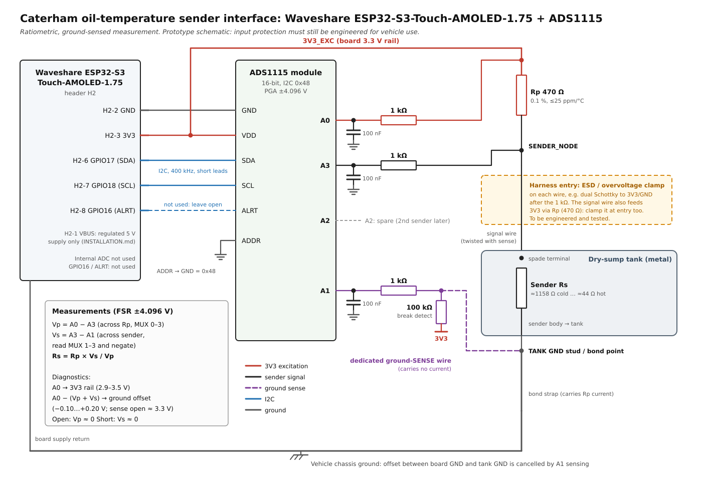
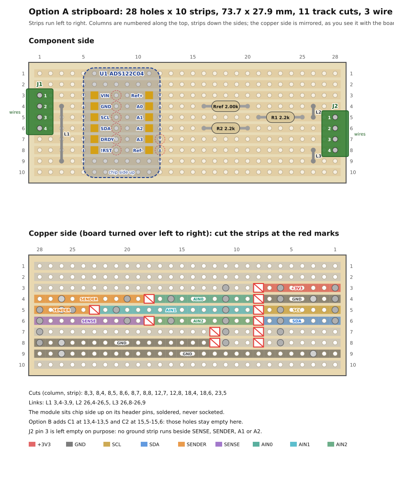
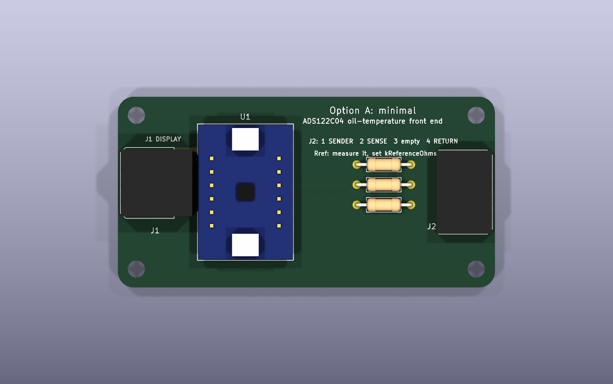

# Option A: the minimal front end

Option A is the simplest version of the gauge's front end: the ADS122C04 module's own current source, a reference resistor and two tap resistors. There's nothing else, so it needs no PCB at all, although a stripboard layout and a PCB are here too.

It's fine on the bench. **For the car, use [option B](../option-b/README.md)** unless option A passes the in-car noise check (step 14 in [WIRING.md](../WIRING.md)). Option B adds two filter capacitors and keeps everything else the same, including the firmware.

## The circuit

| Module pin | Connects to | Part |
|---|---|---|
| VIN, GND, SDA, SCL | the display's `3.3V`, `G`, `17`, `18` | the display lead |
| A0 | `SENDER`, through Rref | **Rref: 2.00 kΩ, 0.1 %, 25 ppm/°C or better** |
| A1 | `SENDER`, through R1 | R1: 2.2 kΩ, 1 % |
| A2 | the ground-sense wire, through R2 | R2: 2.2 kΩ, 1 % |
| A3, Ref+, Ref−, DRDY, !RST | nothing | |

**How it measures:**
- The ADC drives 250 µA out of A0, through Rref and then the sender, to the tank. It reads the voltage across each.
- The resistance is `Rs = Rref × Vs / Vref`. The current's ±6 % accuracy, the ADC's reference and the 3.3 V rail all cancel, so the reading is as good as Rref.
- **Measure Rref** and put its value in `kReferenceOhms` (`main/Config.h`).
- The ground-sense wire reads the tank's own potential, so a ground offset between the gauge and the tank cancels too.

**Faults:** every open joint, broken wire and short shows a fault, never a reading. The ADC's 10 µA burn-out source checks both taps every cycle. [WIRING.md](../WIRING.md) has the full list, the engineering calculations and the bench steps.

**What option A doesn't have:**
- **No input filter.** Interference near the ADC's 256 kHz sampling rate can reach the reading without a fault. Option B fixes this.
- **No clamp diodes or TVS.** At least 2 kΩ between every harness wire and the ADC holds a short to 14.4 V to about 5 mA per pin, within the chip's rating. That isn't load-dump protection, so the short-to-battery bench test (step 12) is owed.

## Three ways to build it

| Build | What it is | Where |
|---|---|---|
| **Without a board** | The three resistors soldered straight onto the module's pins, with a 3-way terminal strip for the harness | [WIRING.md](../WIRING.md), "Building it without a board" |
| **Stripboard** | 73.7 × 27.9 mm (28 holes × 10 strips): 11 track cuts, 3 wire links, two screw terminal blocks | [veroboard/](veroboard/): `layout.svg` and `ASSEMBLY.md` |
| **PCB** | 71 × 36 mm, two layers, plated through-hole, Micro-Fit connectors that lock | [pcb/](pcb/): the KiCad project, `fab/option-a-gerbers.zip` and renders |

[BOM.md](BOM.md) lists the parts for all three: the parts every build needs, then each build's own.

In every build, the module is **soldered in by its header pins, never socketed**, and Rref is measured before it goes in.

### Stripboard

- **J1, the display lead:** 1 3.3V, 2 G, 3 18 (SCL), 4 17 (SDA). The four strips run straight to the module's own pins.
- **J2, the sender harness:**
  - 1 signal wire to the sender;
  - 2 ground-sense wire;
  - 3 **empty**;
  - 4 return wire to the tank bond stud.
- **Upgrading:** option B's C1 and C2 holes (13,4–13,5 and 15,5–15,6) are left empty, so fitting the two capacitors turns this board into option B.

### PCB

- **J1, the display lead (Micro-Fit 2x3):**
  - 4 SDA (17), 5 SCL (18) and 6 3.3V each sit beside a ground (pins 1–3);
  - the three ground wires join at the display plug's `G` pin;
  - J1's grounds reach the module on the top copper, over the signal tracks.
- **J2, the sender harness (Micro-Fit 1x4):** the same as the stripboard's J2, with pin 3 empty.
- **Mis-plugging:** J1 and J2 are different sizes, so neither cable fits the other's header.
- **Mounting:** four M3 holes, 64 × 29 mm apart, and M2.5 nylon standoffs under the module's own holes.
- **Upgrading:** this board has no C1 or C2 pads. For option B, order the [option B PCB](../option-b/pcb/).

## Why the boards look the way they do

- **Return wire:** it lands on the board's ground, so the display lead needs only its four signals. The no-board build needs a fifth wire for it.
- **J2 pin 3 is empty, and no ground copper runs beside A1, A2, SENDER or SENSE.** A solder bridge from any of those to ground would give a believable wrong reading, not a fault. Two examples:
  - **SENSE to ground:** the tank offset adds straight into the sender's voltage.
  - **A1 to ground:** the measurement turns single-ended.

  The stripboard checker refuses a ground strip beside them. On the PCB, a DRC rule keeps their copper at least 1 mm from ground, and there's no ground pour; the closest they actually come is 2.5 mm.
- **R1 meets SENDER at J2 pin 1** by its own track, so it senses at the connector, not partway along the excitation current's path.

## Before you trust it

1. Measure Rref, and set `kReferenceOhms`.
2. Run bench steps 1–13 in [WIRING.md](../WIRING.md), including the tap checks, the pin-pair shorts and the short to battery.
3. Do the in-car noise check (step 14).
4. Calibrate the sender ([CALIBRATION.md](../../docs/CALIBRATION.md)).

Until then it's a bench prototype ([VALIDATION.md](../../docs/VALIDATION.md)).

## Files

Everything here except this README is generated by `scripts/boards/build.sh`, from `scripts/boards/`. That script runs KiCad 10.0.8 in its container (podman or docker).
- **The layouts:**
  - the circuit is `circuit.py`;
  - the stripboard is `vero_layout.py`;
  - the PCB placement and routing are `pcb_layout.py`.
- **Each build:**
  - checks the stripboard layout;
  - runs KiCad's ERC, and DRC with schematic parity;
  - confirms the schematic's netlist is the circuit;
  - writes `outputs.sha256`.
- **Tests:** `tests/test_boards.py` fails if any output is stale, and re-checks the circuit, the stripboard and the PCB's clearances independently.
- **Editing:** never edit the outputs by hand.
