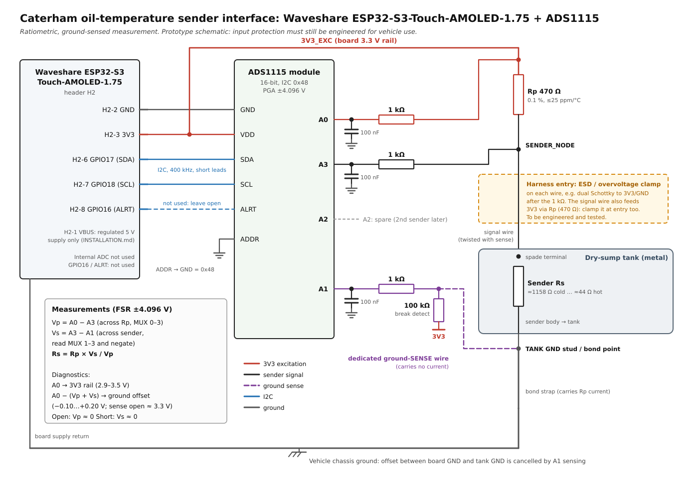
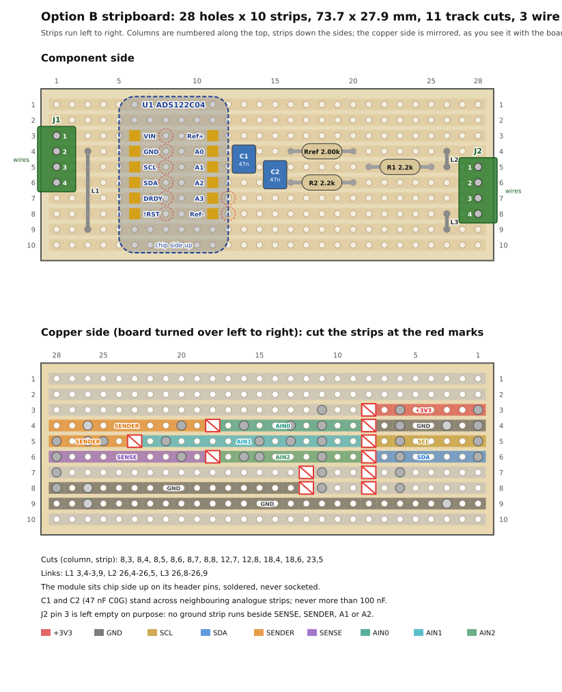
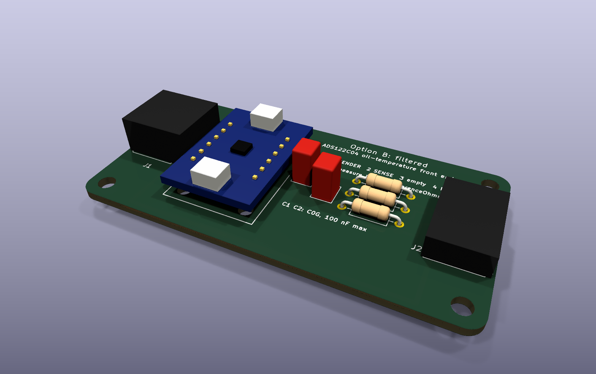

# Option B: the filtered front end (recommended for the car)

Option B is [option A](../option-a/README.md) plus two small capacitors that keep radio-frequency interference out of the ADC. Everything else is the same: the module, the three resistors, the harness, the display lead and the firmware. It's the version to fit in the car.

## The circuit

| Module pin | Connects to | Part |
|---|---|---|
| VIN, GND, SDA, SCL | the display's `3.3V`, `G`, `17`, `18` | the display lead |
| A0 | `SENDER`, through Rref; and C1 to A1 | **Rref: 2.00 kΩ, 0.1 %, 25 ppm/°C or better** |
| A1 | `SENDER`, through R1; C1 to A0 and C2 to A2 | R1: 2.2 kΩ, 1 % |
| A2 | the ground-sense wire, through R2; and C2 to A1 | R2: 2.2 kΩ, 1 % |
| A3, Ref+, Ref−, DRDY, !RST | nothing | |

- **C1:** 47 nF C0G, across A0 and A1.
- **C2:** 47 nF C0G, across A1 and A2.

The measurement is option A's. The ADC drives 250 µA through Rref and the sender, and `Rs = Rref × Vs / Vref`. **Measure Rref** and put its value in `kReferenceOhms` (`main/Config.h`). [WIRING.md](../WIRING.md) has the full description, the faults and the bench steps.

## The filter

**Why it's needed:** the ADC samples its inputs at 256 kHz. Interference close to that frequency, or a multiple of it, folds back into the reading, and no fault check would catch it (datasheet SBAS751B, section 9.1.4). In the car, ignition, alternator and fan noise is the likely source.

**What it does:** with the series resistors, C1 and C2 form low-pass filters with corners around 800 Hz. That's about 50 dB down at 256 kHz.

**C1 and C2 go across pin pairs, never to ground:**
- **Why not to ground:** a textbook filter also puts a capacitor from each input to ground. Here a shorted one would give a believable wrong reading: with A1 shorted to ground and the tank 50 mV below the gauge's ground, a sender at 130 °C reads about 96 °C, with no alarm.
- **Failures across a pair are safe:**
  - C1 shorted: `SENSOR OPEN`;
  - C2 shorted: `SENSOR SHORT`;
  - either one open: exactly option A.

**The cost:** interference common to every wire is left to the ADC's own rejection.

**C0G only, and never more than 100 nF:**
- **Why not X7R or another high-k ceramic:** they're piezoelectric, so the car's vibration becomes voltage across them.
- **Why the 100 nF limit:** with a capacitor on the pin, the burn-out source ramps an open tap instead of snapping it to the rail. The simulation in `tests/front_end_sim_test.cpp` shows the checks still trip from the first cycle at 47 and 100 nF, and at 150 nF in a shorter sweep. From 220 nF, an open R1 can leave a stale reading.

## Three ways to build it

| Build | What it is | Where |
|---|---|---|
| **Without a board** | The three resistors on the module's pins, C1 and C2 soldered underneath across the A0–A1 and A1–A2 joints, and a 3-way terminal strip | [WIRING.md](../WIRING.md), "Building it without a board" |
| **Stripboard** | Option A's board with C1 and C2 added: 73.7 × 27.9 mm, 11 track cuts, 3 wire links, two screw terminal blocks | [veroboard/](veroboard/): `layout.svg` and `ASSEMBLY.md` |
| **PCB** | 71 × 36 mm, two layers, plated through-hole, Micro-Fit connectors that lock | [pcb/](pcb/): the KiCad project, `fab/option-b-gerbers.zip` and renders |

[BOM.md](BOM.md) lists the parts for all three: the parts every build needs, then each build's own.

In every build, the module is **soldered in by its header pins, never socketed**, and Rref is measured before it goes in.

### Stripboard

- **C1 and C2:** each stands across two neighbouring analogue strips (13,4–13,5 and 15,5–15,6), right beside the module.
- **J1, the display lead:** 1 3.3V, 2 G, 3 18 (SCL), 4 17 (SDA).
- **J2, the sender harness:**
  - 1 signal wire to the sender;
  - 2 ground-sense wire;
  - 3 **empty**;
  - 4 return wire to the tank bond stud.

### PCB

- **C1 and C2:** they sit between the module and the resistors, on the A0–A1 and A1–A2 tracks.
- **J1, the display lead (Micro-Fit 2x3):**
  - 4 SDA (17), 5 SCL (18) and 6 3.3V each sit beside a ground (pins 1–3);
  - the three ground wires join at the display plug's `G` pin.
- **J2, the sender harness (Micro-Fit 1x4):** the same as the stripboard's J2, with pin 3 empty.
- **Mis-plugging:** J1 and J2 are different sizes, so neither cable fits the other's header.
- **Mounting:** four M3 holes, 64 × 29 mm apart, and M2.5 nylon standoffs under the module's own holes.

## Why the boards look the way they do

- **Return wire:** it lands on the board's ground, so the display lead needs only its four signals.
- **J2 pin 3 is empty, and no ground copper runs beside A1, A2, SENDER or SENSE.** A solder bridge from any of those to ground would give a believable wrong reading, for the same reason there's no capacitor to ground.
  - **Stripboard:** the checker refuses a ground strip beside them.
  - **PCB:** a DRC rule keeps their copper at least 1 mm from ground, and there's no ground pour; the closest they actually come is 2.5 mm.
- **R1 meets SENDER at J2 pin 1** by its own track, so it senses at the connector.

## Before you trust it

1. Measure Rref, and set `kReferenceOhms`.
2. Run bench steps 1–13 in [WIRING.md](../WIRING.md) with C1 and C2 fitted, including the tap checks, the pin-pair shorts and the short to battery. Expect the same results as option A.
3. Do the in-car noise check (step 14).
4. Calibrate the sender ([CALIBRATION.md](../../docs/CALIBRATION.md)).

Until then it's a bench prototype ([VALIDATION.md](../../docs/VALIDATION.md)).

## Files

Everything here except this README is generated by `scripts/boards/build.sh`, from `scripts/boards/`. That script runs KiCad 10.0.8 in its container (podman or docker).
- **The layouts:**
  - the circuit is `circuit.py`;
  - the stripboard is `vero_layout.py`;
  - the PCB placement and routing are `pcb_layout.py`.
- **Each build:**
  - checks the stripboard layout;
  - runs KiCad's ERC, and DRC with schematic parity;
  - confirms the schematic's netlist is the circuit;
  - writes `outputs.sha256`.
- **Tests:** `tests/test_boards.py` fails if any output is stale, and re-checks the circuit, the stripboard and the PCB's clearances independently.
- **Editing:** never edit the outputs by hand.
