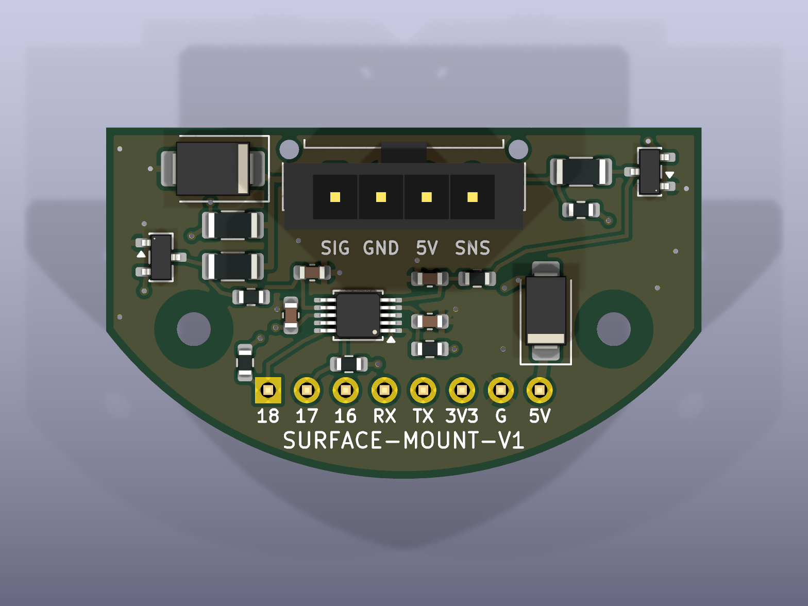
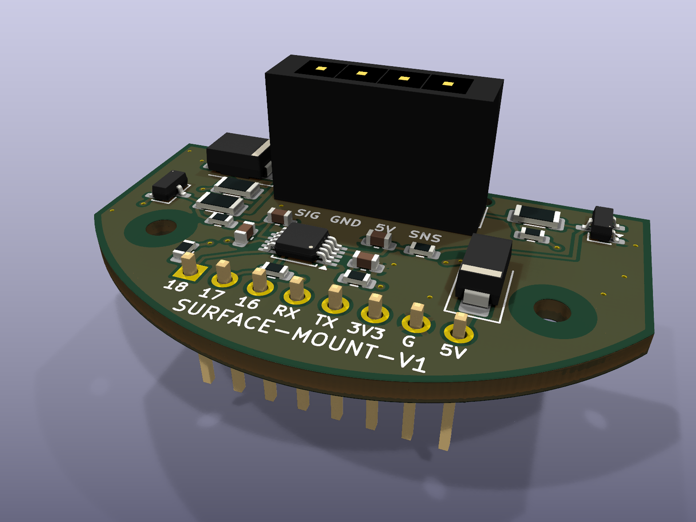
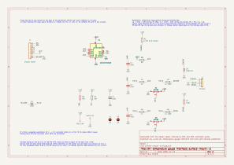

# surface-mount-v1: interface PCB

surface-mount-v1 is the first interface PCB. It's a two-layer board with surface-mount parts, fitted by the board house. It replaces both the veroboard and the separate protection board. It holds:
- the ADS1115 as a bare chip;
- Rp;
- the three input filters;
- the harness protection;
- the I²C pull-ups;
- the 5 V feed.

It plugs straight into the 8-way socket on the back of the Waveshare case, and the case's two bottom screws hold it on. Issue #48.

**Status:** designed, with zero ERC and zero DRC findings. Not yet built or tested; the fit check and bench checks below are owed. Like the rest of the gauge, it's supplementary to the factory warnings ([docs/SAFETY.md](../../../docs/SAFETY.md)).

| | |
|---|---|
| Size | 39 × 23 mm, 783 mm². D-shaped so it sits 1 mm inside the 51 mm case outline: nothing shows around the gauge. For comparison, the veroboard is 66 × 43 mm. |
| Stack-up | 2 layers, 1.6 mm FR-4, 1 oz copper, GND pour on both sides |
| Rules | 0.2 mm clearance, 0.25 mm minimum track, 0.6/0.3 mm vias, 0.5 mm copper to edge. Well inside a standard JLCPCB or PCBWay 2-layer service. |
| Parts | 20 on the board. The board house fits 17 SMD parts; you fit J1, J2 and Rp. |
| Height above the case back | 2.54 mm spacing, then the board, then the J2 header (9.9 mm) and the harness plug |

## Design decisions (from #48)

1. **Vehicle power: a separate automotive 12 V → 5 V converter.** Its 5 V comes in on J2 pin 3 and passes through D4 (SS34) to the display's 5V pin.
   - The display board wires that pin straight to USB-C VBUS and to the AXP2101's input, with no diode (Waveshare schematic).
   - D4 stops USB power feeding back into the converter when both are connected.
   - D4 drops about 0.4 V, which leaves the display inside its 3.9–5.5 V VBUS range.
2. **Mounting: plugged straight into the case socket.** The case's two bottom screws hold the board, through H1/H2, with 2.5 mm spacers.
3. **Protection: PR #34's design, in surface-mount parts.**
   - Each harness tap is two stages: R3/R5 (1 kΩ, 1206), then a BAV99 clamp to 3.3 V and GND, then R4/R6 (1 kΩ). The BAV99 is a 1N4148-class pair, so it leaks nanoamps, not the microamps of a warm Schottky.
   - An SMBJ15A TVS sits on the signal wire. Its breakdown is at least 16.7 V, so it doesn't conduct at 14.4 V.
   - The 100 kΩ break-detect bias stays on the harness side.
4. **Assembly: the board house fits the SMD parts.** The fab files include a JLCPCB-format BOM and placement file. You fit J1, J2 and Rp.
5. **3.3 V for the ADC and Rp: still the display's 3.3V pin, not a local regulator.** I recommended a local regulator in #48 and have reversed that.
   - A wire chafed onto 14.4 V pushes current back into the 3.3 V rail through Rp and the clamps, about 34 mA for the signal wire.
   - A regulator can only source current, so a lightly loaded local rail would rise with the fault and would need its own clamp.
   - The display's rail is the AXP2101's 2 A DCDC1, and the display board's own load absorbs that current.
   - The rail still sees the fault while the gauge is off; see what this board doesn't cover, below.

## Circuit

The measurement is the one in [WIRING.md](../../WIRING.md): Vp = A0 − A3 across Rp, Vs = A3 − A1 across the sender, and Rs = Rp × Vs / Vp. The differences from the veroboard:
- **Every tap is a soldered track.** There's no plug-in module, so the open-tap failure in #39 (a module socket contact lifting) can't happen here.
- **The board carries its own I²C pull-ups (10 kΩ) and 100 nF decoupling.** The display board has no pull-ups on GPIO17/18, and the Adafruit module used to supply them.
- **R2, the A0 tap, is a Kelvin connection to Rp's top pad.** It runs on its own bottom-layer track and joins nothing else on the way.
- **Nothing is in series between Rp and the sender pin.**
- **R7 biases the sense wire on the harness side of R5**, so a broken sense wire still reads `GROUND FAULT`.

`tests/test_surface_mount_v1.py` checks these rules against the design table, and checks J1 against the firmware's pins.

**With a harness wire at 14.4 V:**

| Wire | Into the 3.3 V rail | Dissipation | Into the ADC pin |
|---|---|---|---|
| Signal | about 24 mA through Rp, plus about 10 mA through R3 and D1 | R1 0.26 W (TNPW1206 is rated 0.27 W at film ≤125 °C); R3 0.11 W (1206, 0.25 W) | under 0.5 mA, through R4 |
| Sense | about 10 mA through R5 and D2 | R5 0.11 W | under 0.5 mA, through R6 |

After any such fault, measure Rp again.

## Connectors

The parts list is [BOM.md](BOM.md), also as `surface-mount-v1-bom.csv`. It gives every part with its manufacturer part number, and both connector pinouts.

- **J1, the display header** (Samtec TSW-108-07-G-S, gold):
  - It's fitted on the **bottom** side: its long pins point away from the components and into the case socket.
  - The pin order matches the case label, 18 17 16 RX TX 3.3V G 5V, which is also printed on the top silkscreen.
  - Pin 1 ("18", SCL) has the square pad.
- **J2, the harness** (Molex Micro-Fit 3.0 43650-0415, 1×4 vertical, positive latch):
  - Pins: 1 sender signal, 2 GND, 3 5 V in, 4 ground sense.
  - The mating housing is 43645-0400 with tin 43030 terminals. They take 0.5 mm² (20 AWG) wire with 1.42–1.85 mm insulation; crimp them with the Molex 63819-0000 or a Micro-Fit ratchet crimper.
  - Twist the sender and sense wires together (WIRING.md).

## Fit check before ordering (human)

The positions come from Waveshare's drawing of the cased board (`ESP32-S3-Touch-AMOLED-1.75-B`), not from your unit. Check them with calipers first:

1. **Socket row:** the 8 pins at 2.54 mm pitch, centred left to right, with their centres 18.70 mm below the case centre. Is the socket face flush with the case back? J1's insulator sets a 2.54 mm gap, so a socket that stands proud changes the spacer height.
2. **Bottom screws:** at ±13.75 mm, 14.70 mm below centre.
   - Check they're M2, and measure the length of the originals.
   - The new screws are that length plus 1.6 mm for the board plus the spacer, so they engage the standoffs as far as before and no further.
3. **Overlay check:** print [renders/placement.svg](renders/placement.svg) at 100 % (1 mm grid, case centre at 0,0), or the Gerbers, and lay it on the case back.

If anything differs, change `layout.py` (`J1_Y`, `HOLES`) and rebuild.

## Ordering and assembly

1. **PCB:** upload `fab/surface-mount-v1-gerbers.zip`. Choose 2 layers, 1.6 mm, any colour, and lead-free HASL or ENIG. Five boards is the usual minimum.
2. **Assembly (optional):** top side only. Upload `fab/surface-mount-v1-bom-jlcpcb.csv` and `fab/surface-mount-v1-cpl-jlcpcb.csv`.
   - Board houses and KiCad differ in the zero rotation for some packages, so check every part in the placement preview: U1's pin-1 dot, the stripes on D3 and D4, and the BAV99s.
   - The files leave out J1, J2 and R1.
3. **Hand-fit R1** (Vishay TNPW1206470RBEEA; Digi-Key or Mouser). Measure it first and note the value: it goes in `kPullUpOhms`, with approval (#36).
4. **Hand-fit J2** on the top side.
5. **Hand-fit J1** from the bottom side and solder it on the top.

## Bench checks (human, owed; see docs/VALIDATION.md)

**Readings through the board:**
- Wire a known 120 Ω resistor from J2 pin 1 to a "tank" point, and connect J2 pins 2 and 4 to the same point.
- Then run WIRING.md bench steps 4–10, with J2 standing in for the harness.

**Fault tests:** apply 14.4 V through a 50 mA current limit to J2 pin 1, then to pin 4. Expect no damage and a fault display, and readings that come back correct afterwards (PR #34).

**Retention:** shake test with the screws and spacers fitted.

## What this board doesn't cover

- **A wire chafed onto an always-live feed while the gauge is off** back-powers the 3.3 V rail through Rp.
- **A long load dump on a wire chafed onto the battery feed** can destroy the TVS. If the TVS then fails short, the gauge shows `SENSOR SHORT`.
- **J1 is still a plug contact.** A bad SDA or SCL contact shows as ADC errors (`adc_ok = false`). A bad 3.3V or GND contact shows as supply or ADC faults.
- **It isn't qualified for automotive use.** The bench checks above and the in-car tests (#43) come first.

## What's in this folder

| Path | What it is |
|---|---|
| `README.md` | This page: decisions, fit check, ordering, assembly, checks. Hand-written. |
| `BOM.md`, `surface-mount-v1-bom.csv` | The full parts list: the board, connectors, harness parts and fitting hardware |
| `fab/surface-mount-v1-gerbers.zip` | Gerbers and drill files, to upload to the board house |
| `fab/surface-mount-v1-bom-jlcpcb.csv`, `fab/surface-mount-v1-cpl-jlcpcb.csv` | The board house's assembly BOM and placement file (SMD parts only) |
| `renders/` | `top.png`, `bottom.png`, `iso.png` (3D); `schematic.svg`; `placement.svg` (1 mm grid in case coordinates) |
| `surface-mount-v1.kicad_pro`, `.kicad_sch`, `.kicad_pcb` | The KiCad 10 project |
| `3d/` | The simplified 3D model of J2, for the renders |
| `generator/` | The source: `design.py` (parts, nets, part numbers) and `layout.py` (placement, routing, silkscreen) |
| `build.sh`, `outputs.sha256` | The rebuild script and the hash manifest it writes |

## Rebuilding

`build.sh` (in this folder) regenerates everything here from `generator/`:
- the KiCad schematic and board;
- ERC and DRC, with schematic parity and zone refill. Any finding fails the build.
- the renders, the Gerbers and drill files, the placement file and the BOMs;
- `outputs.sha256`.

It runs KiCad 10.0.8 in its official container through podman or docker; set `KICAD_LOCAL=1` to use a local KiCad 10.0.8. An unchanged design rebuilds byte-for-byte, so a diff means the design changed.

`tests/test_surface_mount_v1.py`, which runs in CI, fails if anything listed in `outputs.sha256` changes without a rebuild.

**Where the design lives:**
- `design.py`: the parts, nets and part numbers.
- `layout.py`: placement, routing and silkscreen, in case coordinates. `renders/placement.svg` shows the same coordinates.

The generator is the source for surface-mount-v1. You can open the KiCad files in KiCad 10, but the next build overwrites them. To take the design over in the KiCad GUI, delete `generator/` and the generator steps from the script.

KiCad has no 3D model for the Micro-Fit header. `3d/Molex_43650-0415_envelope.wrl` is a plain box of the right size for the renders, not Molex's model.
