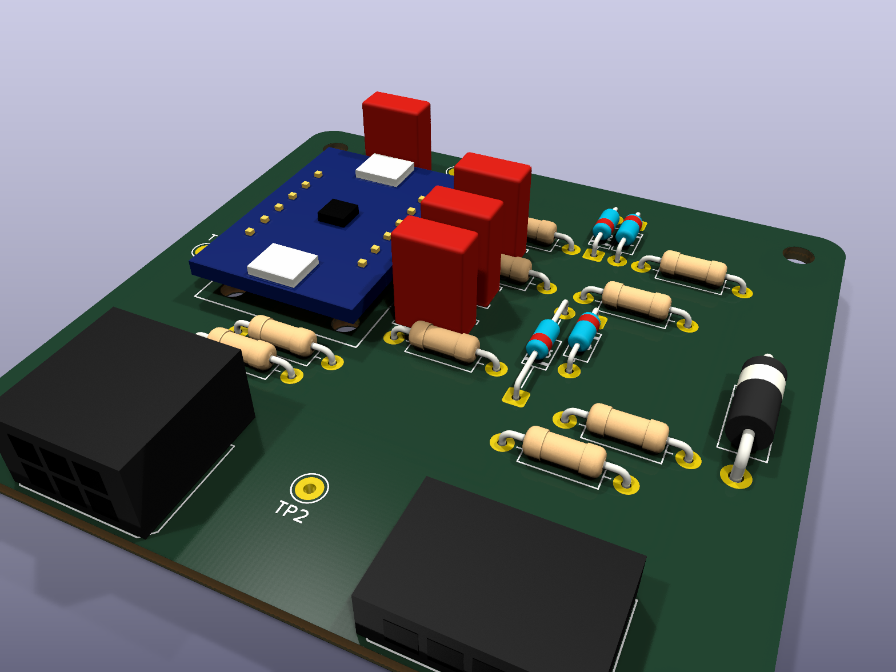
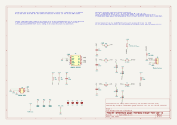
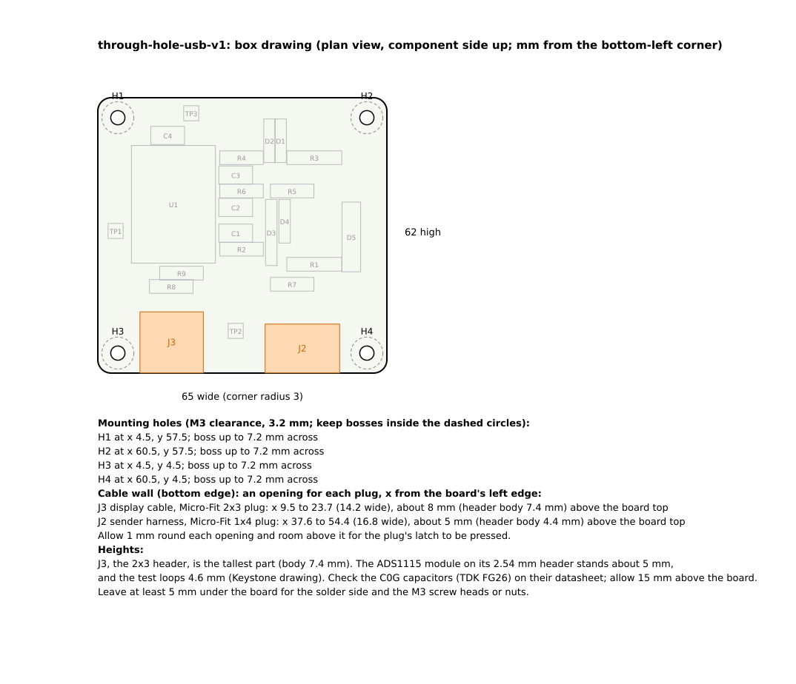

# through-hole-usb-v1: interface PCB

through-hole-usb-v1 is the third interface PCB (issue #54). It's [through-hole-v1](../through-hole-v1/README.md) without the 12 V supply: the display runs from its own USB-C socket, and this board takes its 3.3 V from the display over the cable.
- **One copper layer, through-hole parts only,** all hand-soldered.
- **It lives in its own 3D-printed box,** and a cable connects it to the display. The display doesn't plug into it.
- **It carries the same measurement and protection** as the other two boards.
- **A dedicated ground return comes back from the tank** on the harness connector, because a USB supply needn't share the car's ground (see Grounds, below).

**The firmware is unchanged:** the same ADS1115, address 0x48, GPIO17/18 and inputs.

**Status:** designed, with zero ERC and zero DRC findings. Not yet built or tested; the checks owed are listed below. Like the rest of the gauge, it's supplementary to the factory warnings ([docs/SAFETY.md](../../../docs/SAFETY.md)).

| | |
|---|---|
| Size | 65 × 62 mm, 3 mm corner radius, 4 × M3 mounting holes |
| Copper | **One layer** (bottom), 1 oz, ground pour. No vias, no top copper. |
| Tracks | 0.5 mm signals, 0.6 mm 3.3 V and the sender wire, 0.8 mm grounds; 0.3 mm minimum clearance |
| Pads | At least 0.6 mm of copper round each hole, because a single-sided board has unplated holes |
| Resistors | All lie flat at 10.16 mm: Vishay's MBB0207 datasheet asks for at least 10.0 mm between the leads |
| Parts | 24 through-hole parts plus 4 mounting holes. One part is the Adafruit ADS1115 module, soldered in. |
| Connectors | Two Molex Micro-Fit 3.0 right-angle headers, both along one edge, so both cables leave through one wall of the box |

## What's on it

- **ADC (U1):** the Adafruit ADS1115 breakout (product 1085).
  - The ADS1115 itself only comes in surface-mount packages, so the board takes the module.
  - Solder the module in by its header pins and hold it with nylon standoffs at its four holes. **Never socket it:** a lifting socket contact caused #39.
  - The module brings its own 10 kΩ I²C pull-ups and the 10 kΩ ADDR pull-down (address 0x48). Its A− (the ADC's ground) is joined to GND on the module.
- **Measurement and protection:** [WIRING.md](../../WIRING.md), with PR #34's protection, exactly as on through-hole-v1.
  - **Rp (R1)** is 470 Ω, 0.1 %, 25 ppm, 0.4 W.
  - **R2** is a Kelvin connection on Rp's top pad, on its own track.
  - **Each harness tap is two stages,** 1 kΩ then 1N4148 clamps to 3.3 V and GND then 1 kΩ: R3, D1, D2, R4 for A3, and R5, D3, D4, R6 for A1.
  - **D5** is a P6KE18A TVS on the signal wire.
  - **R7** is the 100 kΩ break-detect bias, on the harness side.
  - **C1–C3** are 100 nF C0G filters to ground.
  - Nothing is in series between Rp and the sender pin.
  - `tests/test_through_hole_usb_v1.py` checks all of this against the design table.
- **3.3 V:** it comes from the display on the cable. There's no 5 V on the cable and no regulator on the board.
  - A harness fault's current goes into the display's 2 A rail, which absorbs it, as on the other boards. With a wire at 14.4 V, that's about 34 mA (signal) or 10 mA (sense).
  - R8/R9 (3.3 kΩ) strengthen the I²C pull-ups for the cable, and C4 decouples 3.3 V at the module.
- **Test points:** TP1 and TP2 are grounds, TP2 on the track from the harness return; TP3 is 3.3 V.

## Power and grounds

**Power.** The display's own USB-C socket powers everything.
- In the car, use a USB-C charger (5 V, 1 A or more) on an **ignition-switched** 12 V circuit, so the gauge turns off with the ignition.
- On the bench, a USB-C supply or a laptop will do. Never connect the harness to the car while a laptop powers the display.
- Don't feed anything into the display's 5V pin: it's joined to the display's USB-C supply.

**Grounds.** On the other boards, the gauge's supply ground is wired to the chassis near the tank bond, and that carries the sender's current back. A USB supply makes no such promise: a power bank floats, and a car USB-C charger reaches the chassis only through its 12 V socket's wiring, somewhere else. So the harness brings its own ground back from the tank:
- **J2 pin 3, the ground return,** runs to the tank bond stud with the signal and ground-sense wires. The sender's excitation current, at most about 6.4 mA, comes back on it.
- **The ground-sense wire (pin 2) still measures the tank's own potential,** so the return wire's resistance doesn't enter the reading.
- **If the return wire breaks while the supply floats,** no sender current flows and the tank floats up to 3.3 V through Rp and the bias. The ground offset then reads about 3.3 V, so the gauge shows `GROUND FAULT`, never a reading.
- **If the charger's ground also reaches the chassis,** the gauge keeps measuring through that path. The ground-sense wire cancels the offset inside its window (−0.10 to +0.20 V), and outside it the gauge shows `GROUND FAULT`.
- **J2 pin 4** takes the harness screen (at this end only) or a second return wire to the same stud.
- **On the board:**
  - a track joins J2's return pins, past TP2, to J3's ground pins;
  - another joins the module's ground to J3;
  - the ground pour covers the rest.

## Connectors and cables

[BOM.md](BOM.md) lists every part with its manufacturer part number and the order codes that were confirmed. It also gives both connector pinouts and the display-cable wiring.

| | Connector | Pins |
|---|---|---|
| **J2** sender | Micro-Fit 1×4 right-angle (43650-0400), plug 43645-0400 | 1 sender signal, 2 ground sense, 3 ground return (to the tank bond stud), 4 GND (screen, or a second return) |
| **J3** display | Micro-Fit 2×3 right-angle (43045-0600), plug 43025-0600 | 1–3 GND, 4 3.3 V, 5 SCL, 6 SDA |

**The harness:** three 0.5 mm² wires to the tank, twisted together.
- The signal wire runs from pin 1 to the sender's spade.
- The ground-sense wire (pin 2) and the return (pin 3) both land on the tank bond stud.
- A 3-core screened cable also works, with its screen on pin 4 at this end only.

**The display cable** carries the I²C bus, so keep it **30 cm or shorter**, and use three twisted pairs of 24 AWG stranded wire:

| Pair | J3 pins | Display socket |
|---|---|---|
| 3.3 V and ground | 4 + 1 | 3.3V + G |
| SCL and ground | 5 + 2 | 18 + G |
| SDA and ground | 6 + 3 | 17 + G |

On J3 each signal pin sits directly above its ground pin.

- **Display end:** an 8-way 2.54 mm gold pin header (Samtec TSW-108-07-G-S) that plugs into the display case socket. Pin order, as the case label reads from the back: 18, 17, 16, RX, TX, 3.3V, G, 5V.
- **Wiring the header:**
  - Solder SCL to the pin labelled 18, SDA to 17 and 3.3 V to 3.3V.
  - Join the three ground wires into one short lead to G.
  - Leave 16, RX, TX and **5V** empty. The 5V pin carries the display's USB supply.
  - Sleeve each joint in heat-shrink, then pot the back of the header or fix it with hot-melt glue so the joints can't flex.
  - The header only friction-fits the socket, so clamp or tie the cable near the display, and the USB-C cable too.
- **Crimping:** both Micro-Fit plugs use 43030-0007 terminals, the same terminal and crimp tool as the other boards.

## The box

`box/through-hole-usb-v1-box.svg` is the drawing for the 3D-printed box. It gives:
- the outline;
- the four M3 hole positions, with the boss size that clears the parts;
- the two cable openings in the bottom wall, at their positions along the edge and their heights;
- the tallest parts.

## Ordering and assembly

1. **Board:** upload `fab/through-hole-usb-v1-gerbers.zip` and choose **1 layer**, 1.6 mm FR-4.
   - The zip holds the bottom copper, bottom mask, top legend, outline and drill file.
   - On a one-layer board the holes aren't plated; JLCPCB's one-layer service, for example, is "NPTH only". The pads are sized for that.
2. **Parts:** order from [BOM.md](BOM.md). Where no order code is given, order by the manufacturer part number.
   - **R1** (Vishay MBB0207VD4700BC100) had only 3 in stock at Digi-Key UK on 2026-11-15, so order it first. Measure it before fitting: the value goes in `kPullUpOhms`, with approval (#36).
3. **Solder lowest to highest:**
   1. resistors and diodes;
   2. the ceramic capacitors;
   3. the test loops;
   4. the connectors;
   5. the module, on its header pins with the standoffs fitted first.

   The silkscreen names every part.

## Checks owed (human; also in docs/VALIDATION.md)

1. **Readings through J2, with the display on USB-C:** WIRING.md bench steps 4–10, with J2 as the harness. J2 pin 3 is the steps' bond wire from the bench "tank ground" point to the board.
2. **The return wire:** disconnect J2 pin 3 with the display on a floating supply (a USB power bank). Expect `GROUND FAULT`, never a reading.
3. **Fault tests:** 14.4 V through a 50 mA limit on J2 pin 1, then pin 2.
4. **I²C over the real cable:** a one-hour soak with no ADC errors in the CSV log.
5. **In the car, from the USB-C charger:** `ground_offset_v` in the CSV log with the engine running and electrical loads on.
6. **Box fit,** and a shake test of the board and the module standoffs.

## Rebuilding

`build.sh` in this folder regenerates everything here from `generator/`:
- the single-sided footprint library (`footprints.pretty`) and the module's symbol;
- the KiCad schematic and board;
- ERC and DRC, with schematic parity and zone refill. Any finding fails the build.
- the renders, the Gerbers and drill file, the box drawing and the parts lists;
- `outputs.sha256`.

It runs KiCad 10.0.8 in its container through podman or docker; set `KICAD_LOCAL=1` to use a local KiCad 10.0.8. An unchanged design rebuilds byte-for-byte.

**Where the design lives:**
- `design.py`: the parts, nets and part numbers.
- `layout.py`: placement and routing, in board coordinates. `renders/placement.svg` shows them.
- `module.py`: the module's geometry, from Adafruit's design files.

KiCad has no 3D model for the two right-angle headers or the module, so `3d/` holds plain boxes of the right size for the renders.

## Not covered

- **A wire chafed onto an always-live feed while the gauge is off** back-powers the 3.3 V rail through Rp.
- **A long load dump** can exceed what D5 absorbs. If it fails short, the gauge shows `SENSOR SHORT`.
- **The USB-C charger** is outside this design. A poor one can reset the display, which then shows nothing until it restarts. A charger on an always-live socket keeps the gauge on with the ignition off.
- **The display-end header and its cable** are friction-fit plug contacts. A bad I²C contact shows as ADC errors; a bad supply contact shows as a supply or ADC fault.
- **It isn't qualified for automotive use;** the checks above and #43 come first.
