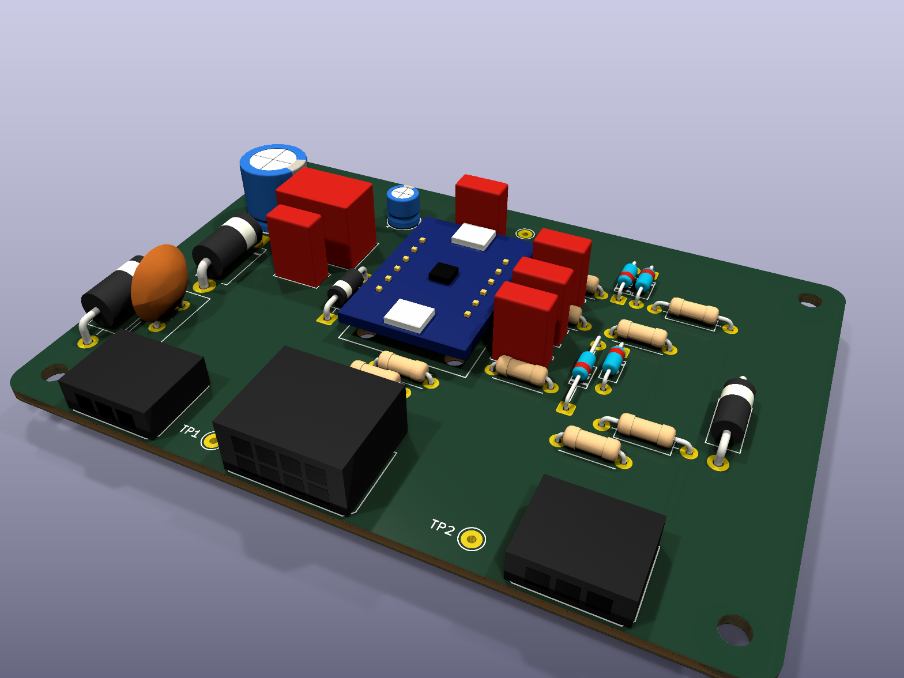
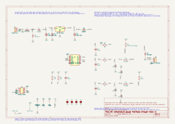
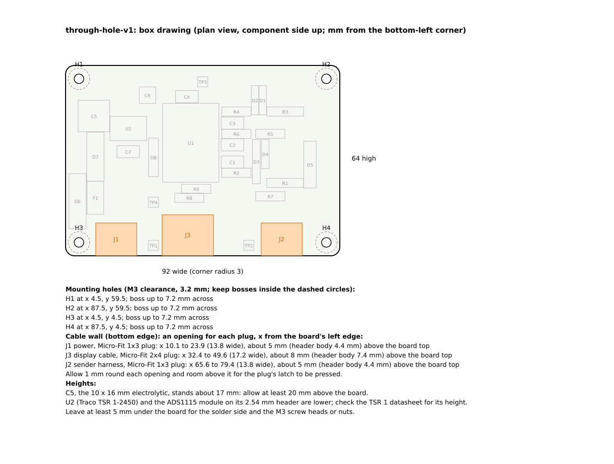

# through-hole-v1: interface PCB

through-hole-v1 is the second interface PCB (issue #51). Every part on it is through-hole and hand-soldered, and the board has one copper layer.
- **It lives in its own 3D-printed box,** and a cable connects it to the display. The display doesn't plug into it.
- **It takes the car's 12 V** and makes the display's 5 V with an on-board switching regulator.
- **It carries the same measurement and protection** as [surface-mount-v1](../surface-mount-v1/README.md).

**The firmware is unchanged:** the same ADS1115, address 0x48, GPIO17/18 and inputs.

**Status:** designed, with zero ERC and zero DRC findings. Not yet built or tested; the checks owed are listed below. Like the rest of the gauge, it's supplementary to the factory warnings ([docs/SAFETY.md](../../../docs/SAFETY.md)).

| | |
|---|---|
| Size | 92 × 64 mm, 3 mm corner radius, 4 × M3 mounting holes |
| Copper | **One layer** (bottom), 1 oz, ground pour. No vias, no top copper. |
| Tracks | 0.5 mm signals, 0.6 mm 3.3 V and the sender wire, 1.0 mm power; 0.3 mm minimum clearance |
| Pads | At least 0.6 mm of copper round each hole, because a single-sided board has unplated holes. Tighter pads (0.45–0.5 mm) only on the small capacitor and the regulator. |
| Parts | 34 through-hole parts plus 4 mounting holes. One part is the Adafruit ADS1115 module, soldered in. |
| Connectors | Three Molex Micro-Fit 3.0 right-angle headers, all along one edge, so every cable leaves through one wall of the box |

## What's on it

- **12 V input (J1):**
  - **F1** is a Bourns MF-R075 resettable fuse.
  - **D6** is a 1.5KE27A TVS. It stays off at 14.4 V and through a 24 V jump-start, and clamps transients.
  - **D7** is a 1N5822 reverse-polarity diode.
  - **C5** is a 220 µF 50 V capacitor.
  - **U2** is a Traco TSR 1-2450 switching regulator, 6.5–36 V in, 5 V out, about 92 % efficient.
  - **D8** is a 1N5817 diode, so USB-C on the display can't feed back into U2.
- **ADC (U1):** the Adafruit ADS1115 breakout (product 1085).
  - The ADS1115 itself only comes in surface-mount packages, so the board takes the module.
  - Solder the module in by its header pins and hold it with nylon standoffs at its four holes. **Never socket it:** a lifting socket contact caused #39.
  - The module brings its own 10 kΩ I²C pull-ups and the 10 kΩ ADDR pull-down (address 0x48). Its A− (the ADC's ground) is joined to GND on the module.
- **Measurement and protection:** [WIRING.md](../../WIRING.md), with PR #34's protection.
  - **Rp (R1)** is 470 Ω, 0.1 %, 25 ppm, 0.4 W.
  - **R2** is a Kelvin connection on Rp's top pad, on its own track.
  - **Each harness tap is two stages,** 1 kΩ then 1N4148 clamps to 3.3 V and GND then 1 kΩ: R3, D1, D2, R4 for A3, and R5, D3, D4, R6 for A1.
  - **D5** is a P6KE18A TVS on the signal wire.
  - **R7** is the 100 kΩ break-detect bias, on the harness side.
  - **C1–C3** are 100 nF C0G filters to ground.
  - Nothing is in series between Rp and the sender pin.
  - `tests/test_through_hole_v1.py` checks all of this against the design table.
- **3.3 V:** it comes back from the display on the cable.
  - A harness fault's current goes into the display's 2 A rail, which absorbs it, as on surface-mount-v1. With a wire at 14.4 V, that's about 34 mA (signal) or 10 mA (sense).
  - R8/R9 (3.3 kΩ) strengthen the I²C pull-ups for the cable, and C4 decouples 3.3 V at the module.
- **Multiple ground pins:**
  - two on the power connector;
  - four on the display connector, one for each twisted pair;
  - one on the harness connector, for the cable screen;
  - two ground test loops (TP1, TP2).

  TP3 (3.3 V) and TP4 (5 V) are the other test points.

## Connectors and cables

[BOM.md](BOM.md) lists every part with its manufacturer part number and Digi-Key UK code. It also gives all three connector pinouts and the display-cable wiring.

| | Connector | Pins |
|---|---|---|
| **J1** power | Micro-Fit 1×3 right-angle (43650-0300), plug 43645-0300 | 1 GND, 2 GND, 3 +12 V (fused, ignition-switched) |
| **J2** sender | Micro-Fit 1×3 right-angle (43650-0300), plug 43645-0300 | 1 sender signal, 2 ground sense, 3 GND (screen, this end only) |
| **J3** display | Micro-Fit 2×4 right-angle (43045-0800), plug 43025-0800 | 1–3 GND, 4 5 V, 5 3.3 V, 6 GND, 7 SCL, 8 SDA |

**The display cable** carries the I²C bus, so keep it **30 cm or shorter**, and use four twisted pairs of 24 AWG stranded wire:

| Pair | J3 pins | Display socket |
|---|---|---|
| 5 V and ground | 4 + 3 | 5V + G |
| 3.3 V and ground | 5 + 6 | 3.3V + G |
| SCL and ground | 7 + 2 | 18 + G |
| SDA and ground | 8 + 1 | 17 + G |

- **Display end:** an 8-way 2.54 mm gold pin header (Samtec TSW-108-07-G-S) that plugs into the display case socket. Pin order, as the case label reads from the back: 18, 17, 16, RX, TX, 3.3V, G, 5V.
- **Wiring the header:**
  - Solder SCL to the pin labelled 18, SDA to 17, 3.3 V to 3.3V and 5 V to 5V.
  - Join the four ground wires into one short lead to G.
  - Leave 16, RX and TX empty.
  - Sleeve each joint in heat-shrink, then pot the back of the header or fix it with hot-melt glue so the joints can't flex.
  - The header only friction-fits the socket, so clamp or tie the cable near the display.
- **Crimping:** all three Micro-Fit plugs use 43030-0007 terminals, the same terminal and crimp tool as surface-mount-v1.

## The box

`box/through-hole-v1-box.svg` is the drawing for the 3D-printed box. It gives:
- the outline;
- the four M3 hole positions, with the boss size that clears the parts;
- the three cable openings in the bottom wall, at their positions along the edge and their heights;
- the tallest parts. C5 stands about 17 mm, so allow at least 20 mm above the board and 5 mm below it.

## Ordering and assembly

1. **Board:** upload `fab/through-hole-v1-gerbers.zip` and choose **1 layer**, 1.6 mm FR-4.
   - The zip holds the bottom copper, bottom mask, top legend, outline and drill file.
   - On a one-layer board the holes aren't plated; JLCPCB's one-layer service, for example, is "NPTH only". The pads are sized for that.
   - PCB Train in Newbury also makes single-sided boards, without solder resist or legend.
2. **Parts:** order from [BOM.md](BOM.md). Digi-Key UK codes are given where they were confirmed; Farnell and RS stock most parts.
   - **R1** (Vishay MBB0207VD4700BC100) had only 3 in stock at Digi-Key UK on 2026-11-15, so order it first. Measure it before fitting: the value goes in `kPullUpOhms`, with approval (#36).
3. **Solder lowest to highest:**
   1. resistors and diodes;
   2. the ceramic capacitors;
   3. the test loops;
   4. F1, D6 and D7;
   5. the electrolytics, watching the polarity;
   6. U2;
   7. the connectors;
   8. the module, on its header pins with the standoffs fitted first.

   The silkscreen names every part.

## Checks owed (human; also in docs/VALIDATION.md)

1. **Power, from a current-limited bench supply:**
   - 12 V in gives about 4.7 V on TP4: 5 V less D8's drop.
   - Reverse polarity draws no damaging current.
   - At 24 V, D6 stays off.
   - Find the input voltage where 5 V drops out. Expect about 7 V; it matters for cranking (#43).
2. **Readings through J2:** WIRING.md bench steps 4–10, with J2 as the harness.
3. **Fault tests:** 14.4 V through a 50 mA limit on J2 pin 1, then pin 4.
4. **I²C over the real cable:** a one-hour soak with no ADC errors in the CSV log.
5. **Box fit,** and a shake test of the board and the module standoffs.

**Cranking:**
- U2 needs 6.5 V. After D7 and F1, that's about 7 V at J1, and C5 bridges only about a millisecond.
- If the starter pulls the battery below about 7 V, the display resets during cranking. The in-car test (#43) shows whether yours does.

## Rebuilding

`build.sh` in this folder regenerates everything here from `generator/`:
- the single-sided footprint library (`footprints.pretty`) and the module's symbol;
- the KiCad schematic and board;
- ERC and DRC, with schematic parity and zone refill. Any finding fails the build.
- the renders, the Gerbers and drill file, the box drawing and the parts lists;
- `outputs.sha256`.

It runs KiCad 10.0.8 in its container through podman or docker; set `KICAD_LOCAL=1` to use a local KiCad 10.0.8. An unchanged design rebuilds byte-for-byte.

**Where the design lives:**
- `design.py`: the parts, nets and part numbers.
- `layout.py`: placement and routing, in board coordinates. `renders/placement.svg` shows them.
- `module.py`: the module's geometry, from Adafruit's design files.

KiCad has no 3D model for the two right-angle headers or the module, so `3d/` holds plain boxes of the right size for the renders.

## Not covered

- **A wire chafed onto an always-live feed while the gauge is off** back-powers the 3.3 V rail through Rp.
- **A long load dump** can exceed what D6 and D5 absorb. If either fails short, the gauge shows a fault (supply or `SENSOR SHORT`).
- **The display-end header and its cable** are friction-fit plug contacts. A bad I²C contact shows as ADC errors; a bad supply contact shows as a supply or ADC fault.
- **It isn't qualified for automotive use;** the checks above and #43 come first.
