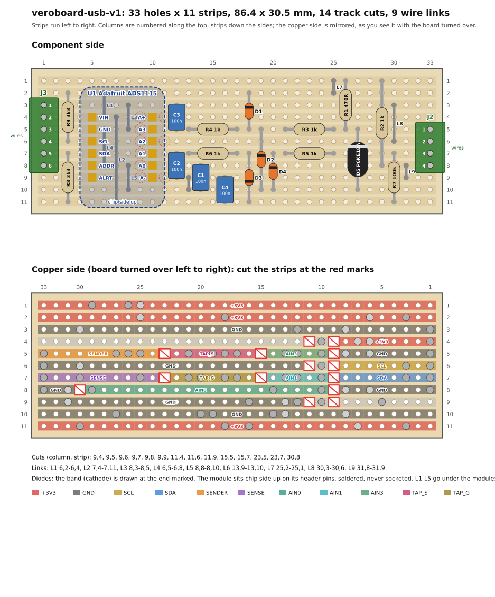

# veroboard-usb-v1: stripboard interface

veroboard-usb-v1 is the fourth interface board (issue #55): [through-hole-usb-v1](../through-hole-usb-v1/README.md)'s circuit built on 0.1 in stripboard, made as small as the parts allow.
- **33 holes by 11 strips, 86.4 × 30.5 mm,** with 14 track cuts and 9 wire links.
- **The display connects only by cable,** to a 6-way screw terminal block. The harness lands in a 4-way block.
- **Power comes from the display,** which runs from its own USB-C socket. The board takes the display's 3.3 V.
- **The harness brings a dedicated ground return** from the tank, because a USB supply needn't share the car's ground.
- **It carries the full harness protection,** unlike the bench veroboard ([hardware/veroboard.svg](../../veroboard.svg)), which has none and stays on the bench.

**The firmware is unchanged:** the same ADS1115, address 0x48, GPIO17/18 and inputs.

**Status:** designed, and the layout passes its checks (below). Not yet built or tested; the checks owed are listed below. Like the rest of the gauge, it's supplementary to the factory warnings ([docs/SAFETY.md](../../../docs/SAFETY.md)).

## What's on it

The circuit is through-hole-usb-v1's, part for part, with the same part numbers. `tests/test_veroboard_usb_v1.py` checks that against that board's design.
- **U1, the Adafruit ADS1115 module (1085),** sits chip side up with its header pins soldered straight into the stripboard.
  - Never socket it: a lifting socket contact caused #39.
  - Its ADDR pin is joined to ground (address 0x48), as WIRING.md says. Its ALRT, A+, A2 and A− pins each sit alone on a cut strip.
- **The measurement and its protection,** as [WIRING.md](../../WIRING.md):
  - **Rp (R1)** is 470 Ω, 0.1 %, 25 ppm.
  - **R2, A0's tap,** meets Rp's top lead from the far end of its strip (strip 1), so no supply current flows in the copper between them (a Kelvin connection).
  - **Each harness tap is two stages:** 1 kΩ, then 1N4148 clamps to 3.3 V and GND, then 1 kΩ. That's R3, D1, D2, R4 for A3, and R5, D3, D4, R6 for A1.
  - **D5,** a P6KE18A TVS, sits on the signal wire.
  - **R7,** the 100 kΩ break-detect bias, is on the harness side.
  - **C1–C3** are 100 nF filters.
  - Nothing is in series between Rp and the harness terminal.
- **I²C:** R8/R9 (3.3 kΩ) strengthen the pull-ups for the cable, and C4 decouples the 3.3 V.

## Layout

[`renders/layout.svg`](renders/layout.svg) draws the board to scale twice:
- **The component side:** every part, link and terminal block, with the cuts underneath shown faintly.
- **The copper side:** mirrored as you see it with the board turned over. Each strip is coloured by its net, and the cuts and every joint are marked.

[`ASSEMBLY.md`](ASSEMBLY.md) lists:
- the cuts;
- the links;
- every part's holes, in fitting order;
- each net's holes, for a continuity check;
- the box sizes.

**Strip plan:**
- **The module** crosses strips 4–9, with its two rows in columns 5 and 10. All six cuts between the rows are in column 9, under it.
- **Rails:** strips 2 and 11 are full-length 3.3 V rails, and 3 and 10 full-length grounds. All four pass under the module. The links that join them to the module's pins (L1–L5) lie under the module too, so fit them first.
- **Right of the module:** A3's and A1's chains run along strips 5 and 7: input, then 1 kΩ, then the tap, then 1 kΩ, then the harness wire. Each resistor has a cut under it. The clamps stand across the strips from each tap to a rail.
- **Strip 1** is Rp's Kelvin strip.

**Part sizes come from the makers' datasheets:**
- **MBB0207 resistors:** Vishay asks for at least 10.0 mm between the leads of one mounted flat, so every resistor spans 4 holes or more.
- **DO-35 diodes:** span 3 holes.
- **The DO-15 TVS:** its body is sized with its mould flash.
- **FG26 capacitors:** 5.0 mm leads, 5.5 × 3.5 mm body.
- **Terminal blocks:** 6.2 mm deep, 8.5 mm tall.
- **The module:** 25.4 × 17.8 mm.

**What the checks cover.** `generator/vero.py` checks the layout, and `tests/test_veroboard_usb_v1.py` runs it:
- **Copper:** the strips, cuts and links join exactly the circuit's nets, and each unused module pin is alone on its strip.
- **Kelvin:** R2's lead is the far-end connection on Rp's strip.
- **Lead spacing:** at least each part's datasheet minimum.
- **Clearances:**
  - no two bodies within 0.2 mm;
  - no lead under another part's body;
  - no lead or link passing over a hole in use;
  - no link crossing another link, or any body except the module's.
- **Terminal blocks:** wire entries face the board's ends with nothing in front. Their faces may overhang the end by 0.56 mm.
- **Edges:** nothing within 1 mm of the two long edges, which sit in slots in the box.

The test also breaks the layout on purpose (a missing cut, a missing link, a short resistor and so on) and checks the checker notices.

## Connectors and cables

The terminal blocks are Phoenix Contact MPT 0,5 at 2.54 mm pitch, so they sit on the stripboard's own grid. They take 0.14–0.5 mm² (26–20 AWG) wire.
- **Display cable:** use 0.25 mm² bootlace ferrules.
- **0.5 mm² harness wire:** strip it 4.5 mm and fit it bare. Phoenix lists ferrules only up to 0.34 mm².
- **Strain relief:** both cables need it at the box wall.

| Block | Pins (pin 1 at the top of the drawing) |
|---|---|
| **J3**, display, 6-way (1725698) | 1 GND, 2 3.3 V, 3 GND, 4 SCL, 5 SDA, 6 GND |
| **J2**, harness, 4-way (1725672) | 1 sender signal, 2 ground return (to the tank bond stud), 3 ground sense, 4 GND (screen, or a second return) |

**The display cable** carries the I²C bus. Keep it **30 cm or shorter**, with three twisted pairs of 24 AWG stranded wire:
- 3.3 V on J3 pin 2, with a ground on pin 1 or 3;
- SCL on pin 4, with a ground on pin 3;
- SDA on pin 5, with a ground on pin 6.

**The display end** is the same as through-hole-usb-v1's: an 8-way 2.54 mm pin header (Samtec TSW-108-07-G-S) in the case socket.
- SCL goes to 18, SDA to 17, 3.3 V to 3.3V, and the three grounds to G.
- Leave 16, RX, TX and **5V** empty. The 5V pin carries the display's USB supply.

**The harness:** three 0.5 mm² wires to the tank, twisted together.
- The signal wire (J2 pin 1) goes to the sender's spade.
- The ground return (pin 2) and the ground-sense wire (pin 3) both go to the tank bond stud.

## Power and grounds

These are the same as through-hole-usb-v1's ([its README](../through-hole-usb-v1/README.md#power-and-grounds)):
- **Power:** in the car, the display runs from a USB-C charger on an ignition-switched circuit. Nothing on this board connects to 5 V or 12 V.
- **The ground return (J2 pin 2)** carries the sender's excitation current back to the board.
- **If it breaks while the supply floats,** the tank floats up to 3.3 V and the gauge shows `GROUND FAULT`, never a reading.

## Building it

1. **Cut the board:** 33 holes along the strips by 11 strips. Cut along the next line of holes outside that, then file the edges smooth (86.4 × 30.5 mm).
2. **Cut the tracks** on the copper side, at the holes in ASSEMBLY.md. The copper side is mirrored: column 1 is on the right with the board turned over.
   - Print `renders/layout.svg` to check against.
   - Check every cut under a magnifier.
3. **Fit the links:** L1–L5 first, because they go under the module. Then L6–L9.
4. **Fit the parts, lowest first:**
   1. resistors;
   2. diodes, with each band at the hole marked K;
   3. the capacitors;
   4. the terminal blocks;
   5. the module, last.
5. **Before power:** check each net's continuity against the list in ASSEMBLY.md. Then check that 3.3 V, GND, SENDER, SENSE, SCL and SDA don't join each other.

**The box:** ASSEMBLY.md gives:
- the board size;
- the two terminal-block openings, at each end;
- the height to allow: 12 mm above the board, 4 mm below.

The board slides into slots along its two long edges. The module is held by its 12 soldered pins; a rib in the lid that bears lightly on its far end stops it rocking.

## Checks owed (human; also in docs/VALIDATION.md)

1. **Before power:** the continuity checks above.
2. **Readings through J2, with the display on USB-C:** WIRING.md bench steps 4–10. J2 pin 2 is the steps' bond wire from the bench "tank ground" point.
3. **The return wire:** disconnect J2 pin 2 with the display on a USB power bank. Expect `GROUND FAULT`, never a reading.
4. **Fault tests:** 14.4 V through a 50 mA limit on J2 pin 1, then pin 3.
5. **I²C over the real cable:** a one-hour soak with no ADC errors in the CSV log.
6. **Box fit,** and a shake test.

## Rebuilding

`build.sh` in this folder regenerates everything here from `generator/`, with only Python 3:
- it checks the layout, and fails on any problem;
- it writes the drawing, the parts lists (`BOM.md`, `veroboard-usb-v1-bom.csv`) and `ASSEMBLY.md`;
- it writes `outputs.sha256`.

**Where the design lives:**
- `design.py`: the parts, nets, part sizes and part numbers.
- `layout.py`: the holes, cuts and links.
- `vero.py`: the checks.

## Not covered

- **A wire chafed onto an always-live feed while the gauge is off** back-powers the 3.3 V rail through Rp.
- **A long load dump** can exceed what D5 absorbs. If it fails short, the gauge shows `SENSOR SHORT`.
- **Stripboard leakage:** between strips, especially if it gets damp. Keep the box sealed.
- **Screw terminals:** they can loosen. Check them after the first drives.
- **The USB-C charger** is outside this design.
- **It isn't qualified for automotive use;** the checks above and #43 come first.
